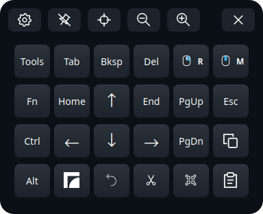

# Frame Tweaks

[](https://github.com/AstronautCheetah/frame-tweaks/actions/workflows/ci.yml)

**Frame Tweaks makes the Valve Steam Frame's desktop mode, and the desktop windows you float in
VR, easier to work in.** It is a checklist of small fixes and add-ons: the keys Steam's
on-screen keyboard is missing, dictation that runs on the headset, curved VR windows, one
clipboard and one KDE wallet for VR and the desktop, and more. Tick what you want; untick it to
remove it again.

<p align="center"></p>

## Why

The Frame runs a full KDE Plasma desktop, but out of the box it is awkward to use from the
headset:

- **Typing is hard.** Steam's on-screen keyboard has no up/down arrows, Esc, Ctrl or F-keys, and
  pointing at keys with a laser is slow.
- **Desktop mode and VR are two separate sessions.** Each has its own clipboard and its own KDE
  wallet, so copy and paste between them doesn't work and apps see two different wallets.
- **Small things are missing or broken.** The mouse pointer can be invisible, there's no
  quick way to snip part of a window, copy its text or hear it read aloud, scroll bars are too
  thin to hit with a laser, and windows you float into VR always start flat.
- **SteamOS's system is read-only and updates replace it**, so the usual ways of installing
  software don't last.

Frame Tweaks fixes these one by one, and installs everything in a way that survives SteamOS
updates.

Not affiliated with or endorsed by Valve. Steam and Steam Frame are trademarks of Valve.

## Install

You need:

- A **Valve Steam Frame** in **desktop mode** (tested on SteamOS 0.4.x; other SteamOS devices
  aren't tested, and the VR tweaks need the Frame's SteamVR).
- A network connection, and `git` (SteamOS has it).
- Some disk space: a few MB for most tweaks. The bigger ones: the full installer window and Arrow
  Pad share a Python setup of about 280 MB, Dictation's Whisper model is about 260 MB, and
  Homebrew (used by a few tweaks) takes several hundred MB or more, depending on what is in it.

In desktop mode, open **Konsole** and run:

```sh
curl -fsSL https://raw.githubusercontent.com/AstronautCheetah/frame-tweaks/main/get.sh | bash
```

This downloads the newest release into `~/frame-tweaks`, adds **Frame Tweaks** to the app menu
(on the desktop and in Steam's VR "+" menu) and opens the installer window. The first time, it
offers to set up the full window (PyQt6, about 280 MB); if you say no, you get a simpler checklist.

<details><summary>Prefer to read the script first?</summary>

```sh
git clone https://github.com/AstronautCheetah/frame-tweaks ~/frame-tweaks
less ~/frame-tweaks/get.sh        # short: finds the newest release, checks it out, opens the installer
~/frame-tweaks/get.sh
```
</details>

**What it touches.** Frame Tweaks installs into your home folder (`~/.local`, `~/.config` and
similar). It never unlocks SteamOS's read-only system (no `steamos-readonly disable`), so
SteamOS updates don't undo it. The few exceptions, each only when you tick the tweak that
needs it:

- **Homebrew** asks for your sudo password once, to create `/home/linuxbrew`. This is the only
  time anything asks for sudo.
- **NordVPN** adds its connections to NetworkManager (`/etc/NetworkManager/system-connections`).
- **Shared KDE wallet** and **VSCodium** install apps from Flathub, which go into the system-wide
  Flatpak folder.

Every tweak installs, checks and removes on its own, and removing one keeps your settings.

**Checked downloads.** Files taken from other projects' releases are pinned to a SHA256 checksum
recorded in this repo, and Arch Linux ARM packages are checked against Arch Linux ARM's signing
key. Programs installed through Homebrew, Flathub, pip or a vendor's own installer (the Claude
tweaks) rely on that tool's checks. Details: [SECURITY.md](SECURITY.md#what-each-tweak-changes-on-your-system).

> **What some tweaks can do on your Frame.** VR dashboard patching turns on SteamVR's dashboard
> DevTools port while SteamVR runs (any program on the Frame could use it). Arrow Pad and
> Dictation type through a virtual keyboard (`/dev/uinput`). Each tweak's access is listed in [SECURITY.md](SECURITY.md#what-each-tweak-changes-on-your-system)
> and on its details page in the installer window, so you can check before you tick it.

## What's included

Each tweak's name links to its own README, with how to use it, its settings, how it works and
what to know.

🧪 marks experimental tweaks. They rely on SteamVR's internals, which Valve can change in any
update. They check those internals each time SteamVR starts and switch the affected part off
(their status says so) until an update catches up; nothing else is affected. A few tweaks
need **SteamVR restarted (or a reboot)** once after installing; the installer tells you which.

Grouped as in the Frame Tweaks window. *Helpers* are installed automatically when a tweak needs
them.

<p align="center"></p>

<!-- generated:tweaks (dev/gen-docs.py, from each tweak's README front matter) -->
### Accessibility

| | Tweak | What you get | Why on a Steam Frame |
|---|---|---|---|
| ⌨️ | [**Dictation**](packs/official/dictation/) | Speech-to-text that runs on the headset itself, with whisper.cpp. Press a shortcut (or 🎤 on Arrow Pad's Tools layer) to start, press again to stop; the text is typed into the app you're using and copied to the clipboard. | Typing with controller lasers on a VR keyboard is slow. The Frame can transcribe speech locally, so you can talk instead, and your voice never leaves the headset. |
| ⌨️ | [**Arrow Pad**](packs/official/arrowpad/) | A small floating pad with arrows, Home/End, PgUp/PgDn, Esc, F-keys, one-shot Ctrl/Alt/Super, right- and middle-click keys, clipboard keys, and buttons for dictation and screen snips. It opens in desktop mode or as its own VR panel, and never takes focus from the app you're using. | Steam's on-screen keyboard has no up/down arrows, Esc, Ctrl or F-keys, and most on-screen keyboards don't work under the Frame's Wayland desktop. |
| ✂️ | [**Screen snip**](packs/official/snip/) | Select a rectangle of the window you're using, then copy it, save it, copy its text (OCR) or have it read aloud (Narrate). Arrow Pad's Tools layer has a button for it. | SteamOS comes with no screenshot tool, and the usual desktop ones can't select a region of a window floating in VR. |

### Convenience

| | Tweak | What you get | Why on a Steam Frame |
|---|---|---|---|
| ⌨️ | [**Full Keyboard**](packs/official/full-keyboard/) (VR) | TaiKeid's Full Keyboard: a full-size keyboard you type on with the controller lasers, with arrows, F-keys, a numpad, Ctrl/Alt and Copy/Paste, for the dashboard and the apps on the headset. | Steam's own VR keyboard lacks keys the desktop needs, such as up/down arrows, Ctrl and F-keys. This installs Full Keyboard from a pinned, checksum-checked release and keeps it updated with the rest of Frame Tweaks. |
| 📋 | [**Shared clipboard**](packs/official/clipboard/) | Copy text in a floating VR window and paste it in the desktop, and the other way round. It runs [clipboard-sync](https://github.com/dnut/clipboard-sync), built from its source. | The Frame's VR session and its desktop mode each have their own clipboard, so text copied in one can't be pasted in the other. |
| 📱 | [**Android Mirror**](packs/official/adb-scrcpy/) 🧪 | Shows your Android phone's screen in a window you can click, type and scroll in, over Wi-Fi (scrcpy with Android's wireless debugging). It finds the phone on the network by itself. | Use your phone without taking the headset off. Google's `adb` tool doesn't run on the Frame's ARM processor, so this installs a build that does; in VR, the window takes the phone's shape. |
| 🖱️ | [**Mouse cursor fix**](packs/official/cursor/) | Makes the mouse pointer visible in desktop mode. | In desktop mode on the Frame, the mouse moves but its pointer isn't shown: the desktop draws it on a separate layer that the headset's view leaves out. |

### VR environment

| | Tweak | What you get | Why on a Steam Frame |
|---|---|---|---|
| 🧩 | [**VR dashboard patching**](packs/official/vr-dashboard/) (helper) 🧪 | The shared part of the VR environment tweaks (Curved world windows, Back to the previous window, Pick up when floating, Scroll strips): it puts their small patches into SteamVR's dashboard while SteamVR runs. Android Mirror uses it too when it's there. Installed automatically. | SteamVR's dashboard, the menu and window space you use in the headset, has no settings for these behaviours. It's a web page, so small patches added to it while SteamVR runs can change them. |
| 🌀 | [**Curved world windows**](packs/official/curvature/) 🧪 | Windows you float into the world start curved, like the dashboard; Toggle Curvature still works. | On the Frame, windows you float out of the dashboard always start flat, and SteamVR has no setting to change that. This presses its Toggle Curvature button for you on each one. |
| ↩️ | [**Back to the previous window**](packs/official/float-return/) 🧪 | After you float the window the dashboard is showing out into the world, the dashboard shows the window it showed before (after 2.5 s), instead of an empty space; and when the shown window closes, it goes back to the one before instead of Steam. | SteamVR leaves the dashboard empty where the floated window was, and falls back to Steam when the shown window closes. This switches back for you, the way a click on that window's dashboard button does. |
| ✋ | [**Pick up when floating**](packs/official/float-grab/) 🧪 | "Float in World" also picks the window up, as grabbing the bar under it does, so you place it in one go; your next click (or letting go of the trigger, if you're still holding it) puts it down. | In SteamVR, floating a window and then placing it takes two steps: press Float in World, then grab the bar under the window. This makes it one. |
| 📜 | [**Scroll strips**](packs/official/scroll-strips/) 🧪 | Big scroll strips beside each window, docked in the dashboard or floating (right and top by default), easy to grab with the laser. Press and drag away from that point to scroll, faster the farther you go; let go to stop. Set them up in the Frame Tweaks window or from a gear beside each window in VR. | In VR you point with a laser, and the scroll bars in desktop apps are sized for a mouse: thin and hard to hit. |
| 🛋️ | [**Recline**](packs/official/recline/) 🧪 | Lie back and keep playing. Press one button (or a controller shortcut) and the direction you're looking becomes level and forward in VR, at a chosen eye height; Reset puts everything back. It works for native apps on the Frame, and your hands move with you. | SteamVR's own recenter only turns you around; it can't tilt the world, so lying down leaves you looking at the ceiling. This builds [Recline-VR](https://github.com/new-waifu/Recline-VR) from its source and installs it for you. |

### Privacy & security

| | Tweak | What you get | Why on a Steam Frame |
|---|---|---|---|
| 🔐 | [**Shared KDE wallet**](packs/official/wallet/) | Puts the apps you choose behind one password: they ask for the KDE wallet's password before they open, and the wallet locks itself again after a while (4 hours unless you change it). The same wallet works in desktop mode and VR, with an unlock dialog where you are, a **Lock Wallet** button, and a keyring for terminal tools such as `gh`. | Frames are often left without a password or shared with family, yet some apps hold private things. This protects just those apps, without locking the whole headset. It also fixes the Frame's two sessions (VR and desktop) each having their own wallet, which lose each other's logins. |
| 🔐 | [**Signal: key in the wallet**](packs/official/signal/) | Signal Desktop keeps the key to your message database in the KDE wallet instead of a plain-text file (an existing plain-text key is moved over), and asks for the wallet password before it opens. | A headset gets passed around, often without a SteamOS login password, and Flathub's Signal otherwise keeps its database key in plain text. |
| 🕵️ | [**Firefox privacy**](packs/official/firefox/) | Makes Firefox harder for websites to track you: it turns on Firefox's strongest anti-fingerprinting (`resistFingerprinting`, from Tor Browser), with letterboxing, WebRTC limits, strict tracking protection, HTTPS-only mode and daily re-randomized canvas readings. | The Frame's hardware (Adreno GPU, the VR desktop's unusual window sizes, touch input) is rare among browsers, so it's easy to fingerprint. |
| 🌐 | [**NordVPN**](packs/official/nordvpn/) (WireGuard) | NordVPN servers in several countries as built-in network connections, with a tray icon. Survives SteamOS updates. | The usual NordVPN install goes into `/usr`, which every SteamOS update wipes, and the Frame's desktop has no network applet to switch VPNs. |

### System

| | Tweak | What you get | Why on a Steam Frame |
|---|---|---|---|
| 🍺 | [**Homebrew**](packs/official/homebrew/) *(helper)* | Homebrew, a package manager for command-line programs. It installs everything into `/home/linuxbrew`. | SteamOS's system partition is read-only and wiped by updates, so programs installed there don't last. Homebrew installs outside it, and several tweaks use it for that reason. |
| 🛠️ | [**Tools**](packs/official/tools/) | `restart-plasmashell`: brings the desktop-mode taskbar and system tray back after a crash, with one button. | In the Frame's nested desktop, nothing restarts a crashed taskbar automatically, and it has to be relaunched inside that session. |
| 🖼️ | [**Menu icons**](packs/official/menu-icons/) | Icons for Konsole, System Settings and other apps that show blank in Steam's VR "+" menu. | Steam only looks icons up in the hicolor theme; these apps' icons exist only in KDE's Breeze theme. |
| ⌨️ | [**ydotool**](packs/official/ydotool/) (helper) | The virtual keyboard that Dictation, Arrow Pad and Scroll strips type through. Installed automatically with them. | On the Frame's desktop (KDE Plasma on Wayland), ordinary programs can't send key presses to other apps. ydotool can: it adds a virtual keyboard to the kernel (`/dev/uinput`), which every app treats as a real one. |
| 🗣️ | [**Speech engine**](packs/official/speech/) (helper) | A voice for the Frame: Piper, an offline, natural-sounding voice, for Screen snip's Narrate, and espeak-ng for KDE's screen reader (Orca) and other apps that speak through speech-dispatcher. Installed automatically with Screen snip. | SteamOS includes speech-dispatcher, the service apps speak through, but no voice for it to use, so Orca and other talking apps stay silent. |

### Developer

| | Tweak | What you get | Why on a Steam Frame |
|---|---|---|---|
| 🧑‍💻 | [**VSCodium**](packs/official/vscodium/) | VSCodium, the code editor VS Code built from its open-source code without Microsoft's telemetry and branding. Installed from Flathub. | For coding on the headset: Flathub has a build for the Frame's ARM processor, and it works well with Arrow Pad and Dictation for typing in VR. |
| 🤖 | [**Claude Code**](packs/official/claude-code/) (command line) | Claude Code, Anthropic's coding agent for the terminal (`claude`), installed with Anthropic's own installer. | Anthropic's installer needs no admin rights and supports the Frame's ARM processor, and it puts everything in your home folder, so SteamOS updates leave it alone. |
| 🤖 | [**Claude Desktop**](packs/official/claude-desktop/) | Claude Desktop, Anthropic's official Linux app (arm64), installed into your home folder and updated with one command. | Anthropic ships it as an apt package for Ubuntu and Debian. SteamOS has no apt and its system files are read-only, so this unpacks the package into your home folder instead. |
<!-- /generated:tweaks -->

## Using the installer window

Open **Frame Tweaks** from the app menu, on the desktop or in Steam's VR "+" menu.

- **Tick** a tweak to install it, **untick** it to remove it, then press **Apply changes**.
  Anything a tweak depends on is added for you.
- **Click a row** for its details page: what it is, why it's there, who made it, what it changes,
  and its README.
- The row's **▶** button opens what the tweak provides (Arrow Pad, Dictate, the NordVPN
  tray…). Tweaks with settings have a **⚙ Settings** button instead, and the wallet's
  row has **🔑 Wallet apps**.
- **↻** removes a tweak and installs it again in one step, keeping its settings.
- Categories fold, and rows or whole categories can be hidden (hiding never removes anything).
- "↑ … available · Update" appears when a newer Frame Tweaks release, or a newer version of an
  app a tweak installs, is out.
- **Diagnostics** saves a report for bug reports, and **🧩 Packs** manages extra packs of tweaks.
- In VR, the controller's **B** goes back, **Y** goes to the top of the list, and **A** ticks
  the row you point at.

<p align="center"></p>

## Using the command line

Everything the window does also works from Konsole, in `~/frame-tweaks` (the window uses the
same code, [`lib/sft.py`](lib/sft.py), or the same tools):

```text
./install.sh                    installer window (desktop mode), or help + status (terminal)
./install.sh list               every tweak and what it does
./install.sh install signal     install (adds what it depends on: here, the wallet)
./install.sh uninstall nordvpn  remove one (keeps its settings)
./install.sh reinstall arrowpad remove and install again in one step (the ↻ button)
./install.sh status             health check, changes nothing
./install.sh check-system       are the SteamOS/SteamVR parts the tweaks rely on still there?
./install.sh debug-info         a redacted report for bug reports
./install.sh info arrowpad      a tweak's details page
./install.sh run arrowpad       its ▶ button
./install.sh settings scroll-strips              show its settings and the allowed values
./install.sh settings scroll-strips color=blue thickness=5   change them (also: --reset)
./install.sh hide nordvpn       hide a row in the window (unhide to show it again)
./install.sh hide-group "VR environment"   hide a whole category (unhide-group)
./install.sh wallet lock        the shared wallet: lock, unlock, status
./install.sh wallet-apps        apps using the wallet (add, --remove, --gate…; --help)
./install.sh timers             close-after timers (--set APP MINUTES, --headset…; --help)
```

`./install.sh status` shows one line per tweak, for example:

```text
$ ./install.sh status
  ✔ dictation       dictate ready (Homebrew whisper.cpp, small model)
  ✔ arrowpad        arrowpad installed
  ! curvature       waiting for a SteamVR restart (restart SteamVR or reboot once)
  ✔ wallet          wallet locked; 5 app launcher(s) routed/gated
  · claude-desktop  not installed
```

Only one install, update or removal can run at a time, from the window or the terminal.

### Adding your own tweaks

Every tweak comes from a *pack*: a folder of tweak folders, each described by the YAML front
matter of its README.md. Frame Tweaks' own tweaks are the official pack
([`packs/official/`](packs/official/)). Put other packs in `~/.local/share/frame-tweaks/packs/`
and trust them (**🧩 Packs** in the window). A pack's tweaks run as you, so only trust packs
from people you trust. How to write one: [docs/mods.md](docs/mods.md).

```text
./install.sh mods               packs, whether each is in use, problems
./install.sh mods trust "My pack"     use it (again after its files change); untrust to stop
./install.sh mods check FOLDER  check a pack or a tweak without using it
```

## Updating

```sh
cd ~/frame-tweaks && ./install.sh update
```

Or, in the Frame Tweaks window: **⟳ Check for updates**, then **⬇ Update to …**, then
**↻ Restart** when it's done (the window also checks when it opens). This moves to the newest
release and re-runs the installer of every tweak you have installed. It first checks that the
release is signed by Frame Tweaks' release key and refuses one that isn't. Nothing updates on its
own: a tweak only changes when you update.

- **Pre-releases:** put `beta` in `~/.config/frame-tweaks/channel` to get them too.
- **Go to a specific release** (for example, to go back): `./install.sh update --to vX.Y.Z`.
- **Keep one tweak as it is** during updates: `./install.sh hold ID` (`unhold` to undo).

**If updates stop.** What's installed keeps working. If another project deletes or changes a
file a tweak downloads, the installer falls back to Frame Tweaks' own copy, checked against the
same checksum. Python packages fall back to the newest versions if the tested ones don't
install, and adb and ydotool keep the copy that works if a new build doesn't run on SteamOS.
The first things to stop working are the 🧪 experimental tweaks, after a SteamVR update; they
switch themselves off, and Android Mirror stays usable as a plain window.

## Removing everything

```sh
cd ~/frame-tweaks && ./install.sh uninstall all   # every tweak, the ones that depend on others first
./install.sh menu --remove                        # the Frame Tweaks app-menu entry and icons
rm -rf ~/frame-tweaks ~/.config/frame-tweaks ~/.local/state/frame-tweaks \
       ~/.local/share/frame-tweaks ~/.local/share/arrowpad ~/.cache/frame-tweaks   # settings, logs, Python setups
```

What stays:

- **Homebrew** (other programs may live in it). `./install.sh uninstall homebrew` prints
  Homebrew's own uninstall command; see [homebrew](packs/official/homebrew/).
- **Your data in other apps' usual places**, such as the KDE wallet itself, adb pairing keys in
  `~/.android`, or VSCodium's settings. Each tweak's uninstaller lists what it keeps as it runs.
- The lines tweaks added to `~/.bashrc` (putting `~/.local/bin` and Homebrew on your `PATH`),
  and `~/.config/environment.d/10-local-bin.conf`. They are harmless; delete them by hand if you
  like.

## Common issues

| Problem | What to do |
|---|---|
| Arrow Pad or Dictation types nothing | `./install.sh status ydotool`, then ▶ **Restart** on the ydotool row (or `systemctl --user restart ydotoold`). |
| "Failed to initialize Wayland" when opening apps | Closing desktop mode can tear it down halfway: Steam removes the desktop's runtime folder while KWin keeps running. Exit desktop mode and open it again, or reboot. |
| The mouse pointer is invisible in desktop mode | Install **Mouse cursor fix**, then reboot (it takes effect at the next desktop-mode start). |
| Taskbar or tray disappeared | ▶ **Restart taskbar** on the Tools row (or `restart-plasmashell`). |
| Wallet password refused, or a second password prompt floats in VR | Only one unlock prompt can be open at a time: close the other one, then unlock from **🔑 Wallet apps** on the wallet's row (or `./install.sh wallet unlock`). See [Shared KDE wallet](packs/official/wallet/). |
| Curved world windows (or another VR tweak) says "waiting for a SteamVR restart" | Restart SteamVR (or reboot) once after installing: SteamVR opens the port these tweaks need only when it starts. |
| Apps show without icons in Steam's "+" menu | Install **Menu icons** (re-run it after installing new apps), then reopen the menu. |
| "Another Frame Tweaks install, update or removal is running" | Wait for the other install window to finish; the lock is released when it closes. |
| Letters come out in the wrong case, or every key acts as if Ctrl/Alt/Super is held | The desktop missed a key's release (often because focus moved to another VR window while the key was down). On Arrow Pad: **Tools → Unstick**. Otherwise turn Caps Lock off, then exit and re-enter desktop mode. |
| Windows and clicks in the desktop act strangely, and its title says "Press right control to **ungrab** input" | **Right Ctrl** toggles the desktop's input grab. Press Right Ctrl once on a physical keyboard (Arrow Pad has no Right Ctrl) to turn it off. |
| Something else | Installer window → **Diagnostics** (or `./install.sh debug-info`), and [open an issue](https://github.com/AstronautCheetah/frame-tweaks/issues/new/choose) with the report. |

### Where the logs are

- **Installs, updates and removals:** one log each in `~/.local/state/frame-tweaks/logs/` (the
  last five are kept).
- **The tweaks' background services:** the user journal, for example
  `journalctl --user -u sft-dashboard` (also `ydotoold`, `wallet-lock-sync`,
  `app-timers`).
- **SteamVR drivers, Recline included:** `~/.local/share/Steam/logs/vrserver.txt`.

`./install.sh debug-info` (or **Diagnostics**) gathers the recent install logs, the status of
every tweak and the services' recent lines into one file in your home folder
(`~/frame-tweaks-debug-….txt`). User, host and phone names and network addresses are removed,
but read it before you share it.

## Good to know about the Frame

- **Desktop mode is nested.** Plasma runs inside the Steam/VR session, with its own D-Bus and
  runtime folder (`XDG_RUNTIME_DIR` is `/run/user/$UID/nested_plasma`). Apps started from the
  desktop, from shortcuts and from VR can see different environments, wallets and keyrings. Many
  tweaks here exist because of this; see [Shared KDE wallet](packs/official/wallet/).
- **Anything installed into `/usr`** (with `steamos-readonly disable` and pacman) disappears at
  the next SteamOS update. Prefer home-folder installs, Flatpaks, or settings in `/etc` (as
  [NordVPN](packs/official/nordvpn/) does).
- **SteamOS's stock KDE wallet has no password.** Set one; see [SECURITY.md](SECURITY.md).
- **Steam's on-screen keyboard:** hold **Shift** for ←/→. Keyboards that only work on X11
  don't work on the Frame's Wayland desktop.
- **Vulkan apps** can crash in the Gamescope WSI layer; try starting them with
  `DISABLE_GAMESCOPE_WSI=1`.

## How this compares

Other Steam Frame projects, and how this one relates:

| Project | Approach | Overlap |
|---|---|---|
| [lhns/steam-frame-nix](https://github.com/lhns/steam-frame-nix) | Nix Home Manager modules, declarative | Two-session fixes, shared clipboard and wallet (our [wallet](packs/official/wallet/) adapts its launcher approach without Nix), VR keyboard patches |
| [curiousjtuber/steam-frame-utils](https://github.com/curiousjtuber/steam-frame-utils) | `setup.sh` and app installers | Cursor fix (adopted from it, credited), Full Keyboard installer |
| [TaiKeid/steam-frame-full-keyboard](https://github.com/TaiKeid/steam-frame-full-keyboard) | A full-size VR keyboard | Installed by our [Full Keyboard](packs/official/full-keyboard/) tweak |
| [techieyann/frame-voice](https://github.com/techieyann/frame-voice), [gripspeak](https://github.com/gripspeak/gripspeak) | Dictation apps | Alternatives to our [Dictation](packs/official/dictation/) |

Frame Tweaks fits if you want a checklist installer without Nix that covers input, VR windows
and the two-session wallet and clipboard problems, with the app setups optional.

## Credits

This builds on [lhns/steam-frame-nix](https://github.com/lhns/steam-frame-nix) (shared clipboard
and wallet launchers, two-session know-how), [curiousjtuber/steam-frame-utils](https://github.com/curiousjtuber/steam-frame-utils)
(cursor fix, proximity sensor), [TaiKeid/steam-frame-full-keyboard](https://github.com/TaiKeid/steam-frame-full-keyboard)
(Arrow Pad style and haptics) and [techieyann/frame-voice](https://github.com/techieyann/frame-voice)
(installer shape), and on whisper.cpp, scrcpy, ydotool, KDE and others. Details and licences:
[CREDITS.md](CREDITS.md). Not affiliated with Valve or any vendor named here.

## Contributing, security, licence

- New tweaks are folders with `install.sh`, `status.sh` and `uninstall.sh`; see
  [CONTRIBUTING.md](CONTRIBUTING.md) and [docs/mods.md](docs/mods.md).
- What touches secrets, and the threat model: [SECURITY.md](SECURITY.md).
- [MIT](LICENSE), except the icons made from KDE Breeze and Noto Color Emoji (their own
  licences; [icons/README.md](icons/README.md)). Changes: [CHANGELOG.md](CHANGELOG.md).
- How it works and why: [docs/DESIGN.md](docs/DESIGN.md); plans: [docs/roadmap.md](docs/roadmap.md).

## Tested on

SteamOS 0.4.5 (build 20261007.6125817), SteamVR build 1791331621, kernel 6.18, one Steam
Frame. SteamOS and SteamVR updates can break tweaks that rely on their internals (the 🧪
experimental tweaks check for this and switch themselves off). Reports from other versions are
welcome: open an issue with your `./install.sh status` output.

## AI use

Much of the code here was written with AI coding assistance. I review every change, test it on
my own Steam Frame, and take responsibility for what ships, so please report anything that
looks wrong.
