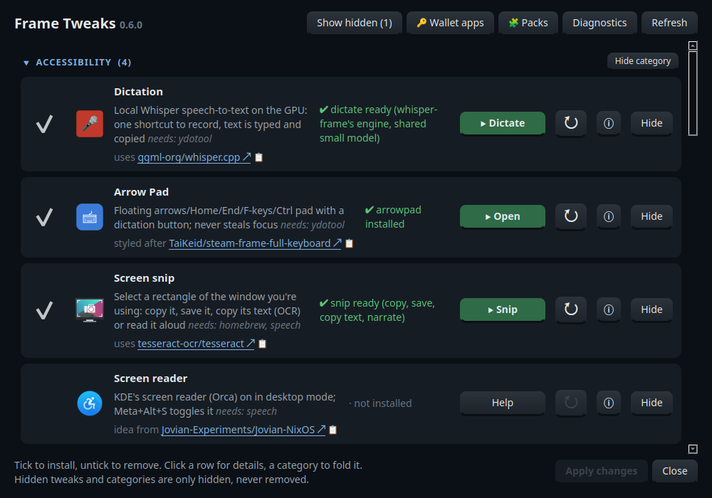
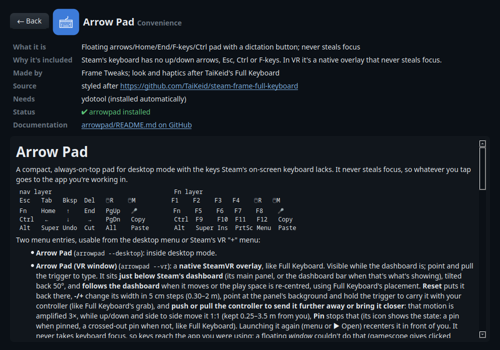

# Frame Tweaks

[](https://github.com/AstronautCheetah/frame-tweaks/actions/workflows/ci.yml)

**Make the Valve Steam Frame's desktop mode, and its floating VR windows, a better place to
work.** The keys the Steam keyboard lacks, local dictation, curved world windows, one clipboard
and one KDE wallet for both sessions, and more: pick what you want from a checklist.

<p align="center"></p>

- **Lives in your home folder.** Nothing touches SteamOS's read-only system, so updates don't
  undo it and nothing needs `steamos-readonly disable`. Two exceptions: Homebrew's one-time
  setup creates `/home/linuxbrew` (the only sudo), and NordVPN adds NetworkManager connections.
- **Pick and choose; remove cleanly.** Every tweak installs, checks and removes on its own,
  and removing keeps your settings.
- **Verified downloads.** Upstream releases are pinned to recorded checksums and Arch Linux ARM
  packages are signature-checked; see [what each tweak changes](SECURITY.md#what-each-tweak-changes-on-your-system).

> **What some tweaks can do on your Frame.** VR dashboard patching turns on SteamVR's dashboard
> DevTools port while SteamVR runs (any program on the Frame could use it), Arrow Pad and
> dictation type through a virtual keyboard (`/dev/uinput`), and Grab guard reads key presses
> to spot one key. Each tweak's access is listed in [SECURITY.md](SECURITY.md#what-each-tweak-changes-on-your-system),
> and in the installer window before you tick it.

Not affiliated with or endorsed by Valve. Steam and Steam Frame are trademarks of Valve.
Parts of this project were written with the help of AI coding assistants; changes are reviewed
and tested on one Steam Frame.

## Requirements

- A **Valve Steam Frame** in **desktop mode** (SteamOS 0.4.x; other SteamOS devices
  aren't tested, and the VR tweaks need the Frame's SteamVR).
- A network connection, and `git` (SteamOS has it).
- Disk space: a few MB for most tweaks; Arrow Pad's and the installer window's Python setup
  takes about 280 MB, Homebrew a few hundred MB, and Whisper models 150–500 MB each.
- Some tweaks need **SteamVR restarted (or a reboot)** once after installing: the installer
  says which.

## Quick start

In desktop mode, open **Konsole** and run:

```sh
curl -fsSL https://raw.githubusercontent.com/AstronautCheetah/frame-tweaks/main/get.sh | bash
```

It installs the newest release into `~/frame-tweaks`, adds **Frame Tweaks** to the app menu
(desktop and the VR "+" menu) and opens the checklist.

<details><summary>Prefer to read it first?</summary>

```sh
git clone https://github.com/AstronautCheetah/frame-tweaks ~/frame-tweaks
less ~/frame-tweaks/get.sh        # 30 lines: finds the newest release tag, clones it, opens the installer
~/frame-tweaks/get.sh
```
</details>

## Core: fixes for the Frame

🧪 marks experimental tweaks: they rely on SteamVR's internal code, which Valve can change in
any update. They check it first and switch themselves off (their status says so) until a Frame
Tweaks update catches up; nothing else is affected.

<p align="center"></p>

<!-- generated:core (dev/gen-docs.py, from each tweak's meta) -->
| | Tweak | What you get | Why (on the Frame) |
|---|---|---|---|
| ⌨️ | [**Dictation**](packs/official/dictation/) | Speech-to-text that runs on the Frame's GPU (Whisper, ~3.5 s for 11 s of speech). One shortcut or the Arrow Pad's 🎤 to start/stop; the text is typed into the focused app, copied, and logged. | Typing on a VR keyboard with controller lasers is slow. The Frame's Adreno GPU is fast enough to transcribe locally, so nothing leaves the headset. |
| 🎙️ | [**whisper-frame**](packs/official/whisper-frame/) | groffta's dictation: hold the headset's Select button, or the mic under any floating window. Installed from upstream; shares dictation's model. | Dictate without menus or the desktop, straight into the window you're looking at in VR. |
| ⌨️ | [**Arrow Pad**](packs/official/arrowpad/) | Floating pad with arrows, Home/End, PgUp/PgDn, F-keys, one-shot Ctrl/Alt/Super, right/middle-click toggles, clipboard keys and a 🎤 button. Opens in desktop mode or as its own VR window; never steals focus. | Steam's on-screen keyboard has no up/down arrows, Esc, Ctrl or F-keys, and most on-screen keyboards don't work under the Frame's Wayland desktop. |
| ✂️ | [**Screen snip**](packs/official/snip/) | Select a rectangle of the window you're using, then copy it, save it, copy its text (OCR) or read it aloud (Narrate). Arrow Pad's Tools layer has a button for it. | SteamOS has no screenshot tool, and none of the usual ones can select a region inside VR. |
| 🔊 | [**Screen reader**](packs/official/screen-reader/) | KDE's screen reader (Orca, part of SteamOS) reads the desktop aloud; Meta+Alt+S toggles it. | Orca ships with SteamOS but is off, and its switch is buried in System Settings; this turns it on for desktop mode. |
| ⌨️ | [**Full Keyboard**](packs/official/full-keyboard/) (VR) | TaiKeid's full-size VR keyboard for the dashboard and desktop (checksum-verified install). | The best in-VR keyboard so far; this installs and updates it with the rest. |
| 📋 | [**Shared clipboard**](packs/official/clipboard/) | Copy in a floating VR window, paste in the desktop, and back. | The Frame's VR session and its nested desktop each have their own clipboard. This runs [clipboard-sync](https://github.com/dnut/clipboard-sync), built from upstream, as steam-frame-nix does. |
| 🖱️ | [**Mouse cursor fix**](packs/official/cursor/) | Makes the pointer visible in desktop mode. | KWin draws the pointer on a hardware plane that the headset's view doesn't show, so in desktop mode the mouse moves invisibly. |
| 🌀 | [**Curved world windows**](packs/official/curvature/) 🧪 | Windows you float into the world start curved, like the dashboard; Toggle Curvature still works. | SteamVR has no setting for it (world windows always start flat), so a tiny dashboard patch presses the toggle for you. Restart SteamVR once after installing. |
| ↩️ | [**Back to the previous window**](packs/official/float-return/) 🧪 | After you float the window the dashboard is showing out into the world, the dashboard shows the window it showed before (after 2.5 s), instead of an empty space; and when the shown window closes, it goes back to the one before instead of Steam. | SteamVR leaves the dashboard empty where the floated window was; this switches back the way a click on that window's dashboard button does. |
| ✋ | [**Pick up when floating**](packs/official/float-grab/) 🧪 | "Float in World" also picks the window up, as grabbing the bar under it does, so you place it in one go; your next click (or letting go of the trigger, if you're still holding it) puts it down. | Floating a window and then grabbing its bar to place it takes two clicks; this makes it one. |
| 📜 | [**Scroll strips**](packs/official/scroll-strips/) 🧪 | Big scroll strips beside each window, docked in the dashboard or floating (right and top by default), easy to grab with the laser. Press and drag away from that point to scroll, faster the farther you go; let go to stop. Position and thickness are set in the installer window. | Desktop scroll bars are sized for a mouse and hard to hit with a laser. |
| 🔐 | [**Shared KDE wallet**](packs/official/wallet/) | One wallet for desktop mode *and* VR, an unlock dialog that works on the desktop, 4-hour auto-lock, a **Lock Wallet** button, closing that really locks, password-gated apps, and CLI credentials (`gh`) kept out of plain-text files. | The Frame runs two sessions (VR and a nested desktop) with separate D-Bus buses, so apps get two wallets that overwrite each other. The VR-side password prompt floats in VR, and terminal tools find no keyring at all. SteamOS's stock wallet has no password. |
| 🧮 | [**Memory caps**](packs/official/memcap/) | Memory limits for Whisper (dictation), scrcpy (Android Mirror) and VSCodium, adjustable in one file. | One runaway app can use up the Frame's memory and stall VR. systemd caps an app per process group, without root. |
| 🛠️ | [**Tools**](packs/official/tools/) | `restart-plasmashell`: bring the taskbar and tray back after a crash. | In the Frame's nested desktop, nothing restarts a crashed taskbar automatically, and it has to be relaunched inside that session. |
| 🖼️ | [**Menu icons**](packs/official/menu-icons/) | Icons for Konsole, System Settings and other apps that show blank in Steam's VR "+" menu. | Steam only looks icons up in the hicolor theme; these apps' icons exist only in KDE's Breeze theme. |
| 🔓 | [**Grab guard**](packs/official/grab-guard/) | Tells you when desktop mode has taken all input (windows stop responding) and how to undo it. | A Right Ctrl press makes desktop mode grab every key and click; nothing on screen says so except its window title. |
<!-- /generated:core -->

## Extras: app setups

<details><summary>Android mirroring, Signal and Firefox hardening, NordVPN, VSCodium, Claude. One person's setup, packaged so others can use it.</summary>

<!-- generated:extras (dev/gen-docs.py, from each tweak's meta) -->
| | Tweak | What you get | Why (on the Frame) |
|---|---|---|---|
| 📱 | [**Android Mirror**](packs/official/adb-scrcpy/) 🧪 | Mirror and control your Android phone in a desktop window (scrcpy over wireless adb). Finds the phone's changing port automatically. | Use your phone without taking the headset off. Google ships `adb` only for x86, so this installs an aarch64 build that runs on the Frame. |
| 🔐 | [**Signal: key in the wallet**](packs/official/signal/) | Signal's database key in the wallet instead of plain text (an existing plain-text key is moved over). Password first and Close after are set in Wallet apps. | A headset gets passed around: shared with family, often without a SteamOS login password. Flathub Signal otherwise keeps its key in plain text. |
| 🕵️ | [**Firefox privacy**](packs/official/firefox/) | Firefox's strongest anti-fingerprinting (the Tor Browser approach), letterboxing, WebRTC limits, daily re-randomization. | The Frame's hardware (Adreno GPU, VR-desktop screen size, touch input) is rare among browsers, so it's easy to fingerprint. |
| 🌐 | [**NordVPN**](packs/official/nordvpn/) (WireGuard) | NordVPN servers in several countries as built-in network connections, with a tray icon. Survives SteamOS updates. | The usual NordVPN install goes into `/usr`, which every SteamOS update wipes, and the Frame's desktop has no network applet to switch VPNs. |
| 🧑‍💻 | [**VSCodium**](packs/official/vscodium/) | VS Code without telemetry, from Flathub. | Coding on the headset: Flathub has the aarch64 build; pairs with Arrow Pad and dictation. |
| 🤖 | [**Claude Code**](packs/official/claude-code/) (command line) | Anthropic's coding agent in the terminal (`claude`), via Anthropic's own installer. | The native installer runs without root on arm64 and updates itself, so SteamOS updates leave it alone. |
| 🤖 | [**Claude Desktop**](packs/official/claude-desktop/) | Anthropic's official Linux arm64 beta, installed and updated without apt. | It's packaged as a `.deb` for Ubuntu/Debian. SteamOS has no apt and a read-only root, so this unpacks the arm64 build into your home folder. |
<!-- /generated:extras -->
</details>

## Helpers

Installed automatically when a tweak needs them; listed so you can see and manage them.

<!-- generated:helper (dev/gen-docs.py, from each tweak's meta) -->
| | Tweak | What you get | Why (on the Frame) |
|---|---|---|---|
| 🧩 | [**VR dashboard patching**](packs/official/vr-dashboard/) (helper) 🧪 | Lets the VR windows tweaks (Curved world windows, Back to the previous window, Pick up when floating, Scroll strips) and Android Mirror adjust SteamVR's dashboard. Installed automatically. | SteamVR's dashboard is a web page with no settings for these behaviours; each VR windows tweak is a small patch this injects while SteamVR runs. |
| 🍺 | [**Homebrew**](packs/official/homebrew/) | The package manager several tweaks install their programs with, into `/home/linuxbrew`. | SteamOS's system partition is read-only and wiped by updates; Homebrew installs outside it. Other tweaks offer to install it when needed; this row shows it and installs it up front. |
| ⌨️ | [**ydotool**](packs/official/ydotool/) (helper) | The virtual keyboard Dictation and Arrow Pad type through. Installed automatically. | Under KDE Wayland ordinary programs can't send keystrokes to other apps; ydotool goes through the kernel's `/dev/uinput`. |
| 🗣️ | [**Speech engine**](packs/official/speech/) (helper) | Gives the Frame a voice: Piper (offline, natural) for Screen snip's Narrate, and espeak-ng for Orca and other apps that speak through speech-dispatcher. Installed automatically. | SteamOS ships speech-dispatcher and its espeak-ng module, but not espeak-ng itself, so nothing can speak (the Screen reader's Orca was silent). |
<!-- /generated:helper -->

Each folder's README covers usage, settings, how it works and the gotchas we hit.

## Using the installer

**Frame Tweaks** in the app menu opens the installer window. Tick to install, untick to
remove, **click a row** for details and its README, **▶** to open what a tweak provides.
Categories fold, and rows or whole categories can be hidden (never removed). Rows show
"↑ available · Update" when a newer version is out. In VR the controller's **B** goes back,
**Y** home, and **A** ticks the row you point at.

<p align="center"></p>

```text
./install.sh                    installer window (desktop mode), or help + status (terminal)
./install.sh uninstall all      remove every tweak (settings kept; see "Remove everything")
./install.sh install signal     install (adds dependencies: wallet)
./install.sh status             health check, changes nothing
./install.sh update             move to the newest release and re-run what's installed
./install.sh update --to v0.3.1 go to a specific release (roll back)
./install.sh hold wallet        keep a tweak as it is during updates (unhold to undo)
./install.sh uninstall nordvpn  remove one (keeps its settings)
./install.sh reinstall arrowpad remove and install again in one step (also the ↻ button)
./install.sh check-system       are the SteamOS/SteamVR parts the tweaks rely on still there?
./install.sh debug-info         a redacted report for bug reports
./install.sh list
```

Everything the installer window does has a command too (the window uses the same code,
[`lib/sft.py`](lib/sft.py), or the same tools):

```text
./install.sh info arrowpad      a tweak's details page
./install.sh run arrowpad       its Run / Open button
./install.sh settings scroll-strips              show its settings and the allowed values
./install.sh settings scroll-strips color=blue thickness=5   change them (also: --reset)
./install.sh settings adb-scrcpy PHONE_MAX_FPS=90             (Android Mirror's stream)
./install.sh hide nordvpn       hide a row in the window (unhide to show it again)
./install.sh hide-group "VR windows"   hide a whole group (unhide-group)
./install.sh wallet lock        the shared wallet: lock, unlock, status
./install.sh wallet-apps        apps using the wallet (wallet-launcher: add, --remove, --gate…)
./install.sh timers             close-after timers (app-timers: --set APP MINUTES, --headset…)
```

Updates follow stable releases. To also get pre-releases, put `beta` in
`~/.config/frame-tweaks/channel`. Every install, update and removal is logged in
`~/.local/state/frame-tweaks/logs/`, and only one can run at a time.

```text
$ ./install.sh status
  ✔ dictation       dictate ready (whisper-frame's engine, shared small model)
  ✔ arrowpad        arrowpad installed
  ! curvature       waiting for a SteamVR restart (restart SteamVR or reboot once)
  ✔ wallet          wallet locked; 5 app launcher(s) routed/gated
  · claude-desktop  not installed
```

## Remove everything

```sh
cd ~/frame-tweaks && ./install.sh uninstall all     # every tweak, dependents first
rm -f ~/.local/share/applications/io.github.AstronautCheetah.FrameTweaks.desktop
rm -rf ~/frame-tweaks ~/.config/frame-tweaks ~/.local/state/frame-tweaks   # settings and logs
```

Homebrew stays (other programs may live in it); its own uninstaller is in
[homebrew/](packs/official/homebrew/). Settings a tweak kept in their usual places (e.g. `~/.config/frame-tweaks/phone.conf`,
`~/.config/frame-tweaks/dictate.conf`) are listed by its uninstaller as it runs.

## If updates stop

Frame Tweaks is built to keep working when nobody is updating it:

- **What's installed keeps working.** Nothing updates itself; a tweak changes only when you run
  an update.
- **Downloads keep working** if an upstream project deletes or changes a file: installs fall back
  to Frame Tweaks' own copy (checked against the same SHA256). Python packages fall back to the
  newest versions, and adb and ydotool keep the copy that works if a new build doesn't run.
- **What stops first:** the 🧪 experimental tweaks, after a SteamVR update changes what they rely
  on. They switch themselves off and their status says so; the rest is unaffected. Android
  Mirror stays usable as a plain window.
- **Staying on a release that works for you:** `./install.sh update --to vX.Y.Z` moves to a given
  release, and `./install.sh hold ID` keeps a tweak as it is during updates.

## Common issues

| Problem | What to do |
|---|---|
| Arrow Pad or dictation types nothing | `./install.sh status ydotool`; ▶ **Restart** on the ydotool row (or `systemctl --user restart ydotoold`). |
| "Failed to initialize Wayland" when opening apps | Steam tore down part of desktop mode on the way out. Exit desktop mode and open it again, or reboot. |
| The mouse pointer is invisible in desktop mode | Install **Mouse cursor fix**, then reboot (it takes effect at the next desktop-mode start). |
| Taskbar or tray disappeared | ▶ **Restart taskbar** on the Tools row (`restart-plasmashell`). |
| Wallet password refused, or a second password prompt floats in VR | Only one unlock prompt can be open: close the other, then use **Unlock** on the Wallet row. See [wallet](packs/official/wallet/#one-unlock-route-our-dialog-never-ksecretds-prompt). |
| Curved world windows "waiting for a SteamVR restart" | Restart SteamVR (or reboot) once after installing; SteamVR opens the port it needs only when it starts. |
| Apps show without icons in Steam's "+" menu | Install **Menu icons** (re-run it after installing new apps), then reopen the menu. |
| "Another Frame Tweaks install … is running" | Wait for the other install window to finish; the lock is released when it exits. |
| Letters come out in the wrong case, or every key acts as if Ctrl/Alt/Super is held | The desktop missed a key's release (often: focus moved to another VR window while the key was down). On Arrow Pad: **Tools → Unstick**. Otherwise turn Caps Lock off, then exit and re-enter desktop mode. |
| Windows and clicks in the desktop act strangely; its title says "Press right control to **ungrab** input" | **Right Ctrl** toggles the desktop's input grab. Press Right Ctrl once on a keyboard (Arrow Pad has no Right Ctrl) to turn it off. |
| Something else | Installer window → **Diagnostics** (or `./install.sh debug-info`), and [open an issue](https://github.com/AstronautCheetah/frame-tweaks/issues/new/choose) with the report. |

## Things worth knowing about the Frame

- **Desktop mode is nested.** Plasma runs inside the Steam/VR session with its own D-Bus and
  `XDG_RUNTIME_DIR` (`/run/user/$UID/nested_plasma`). Apps started from the desktop, from
  shortcuts and from VR can see different environments, wallets and keyrings. Many tweaks
  here exist because of this; see [wallet](packs/official/wallet/).
- **Anything installed into `/usr`** (via `steamos-readonly disable` + pacman) disappears at the
  next SteamOS update. Prefer home-folder installs, Flatpaks, or config in `/etc` (as
  [nordvpn](packs/official/nordvpn/) does).
- **SteamOS's stock KDE wallet has no password.** Set one; see [SECURITY.md](SECURITY.md).
- **Steam's on-screen keyboard:** hold **Shift** for ←/→.
  X11-only on-screen keyboards (e.g. CoreKeyboard) don't work under the Wayland desktop.
- **Closing desktop mode can half-tear it down.** Steam may delete the nested session's runtime
  folder while KWin keeps running, so new apps fail with "Failed to initialize Wayland". Exit
  and reopen desktop mode, or reboot.
- **Vulkan apps** can crash in the Gamescope WSI layer; try `DISABLE_GAMESCOPE_WSI=1`.

## How this compares

Other Frame projects, and how this one relates:

| Project | Approach | Overlap |
|---|---|---|
| [lhns/steam-frame-nix](https://github.com/lhns/steam-frame-nix) | Nix Home Manager modules, declarative | Two-session fixes, shared wallet (our [wallet](packs/official/wallet/) adapts its launcher approach without Nix), VR keyboard patches |
| [curiousjtuber/steam-frame-utils](https://github.com/curiousjtuber/steam-frame-utils) | `setup.sh` + app installers | Cursor fix (adopted from here, credited), Full Keyboard installer |
| [TaiKeid/steam-frame-full-keyboard](https://github.com/TaiKeid/steam-frame-full-keyboard) | Native VR keyboard | Installed by our `full-keyboard` |
| [techieyann/frame-voice](https://github.com/techieyann/frame-voice), [groffta/whisper-frame](https://github.com/groffta/whisper-frame), [gripspeak](https://github.com/gripspeak/gripspeak) | Dictation apps | Alternatives to our [dictation](packs/official/dictation/) |

**Choose this if** you want a checklist installer without Nix, covering input, VR windows and the
two-session wallet and clipboard problems; the extras are optional.

## Credits

This builds on [lhns/steam-frame-nix](https://github.com/lhns/steam-frame-nix) (shared-wallet
launchers, two-session know-how), [curiousjtuber/steam-frame-utils](https://github.com/curiousjtuber/steam-frame-utils)
(cursor fix, proximity sensor), [TaiKeid/steam-frame-full-keyboard](https://github.com/TaiKeid/steam-frame-full-keyboard)
(Arrow Pad style and haptics) and [techieyann/frame-voice](https://github.com/techieyann/frame-voice)
(installer shape), and on whisper.cpp, scrcpy, ydotool, KDE and others. Details and licenses:
[CREDITS.md](CREDITS.md). Not affiliated with Valve or any vendor named here.

## Contributing, security, license

- New tweaks are folders with `install.sh` / `status.sh` / `uninstall.sh`; see
  [CONTRIBUTING.md](CONTRIBUTING.md).
- What touches secrets, and the threat model: [SECURITY.md](SECURITY.md).
- [MIT](LICENSE). Changes: [CHANGELOG.md](CHANGELOG.md).

## Tested on

SteamOS 0.4.5 (build 20261007.6125817), SteamVR build 1791331621, kernel 6.18, one Steam
Frame. SteamOS and SteamVR updates can break tweaks that rely on their internals (the VR
windows tweaks check SteamVR's dashboard code and switch themselves off if it changed). Reports from other
headsets and versions are welcome: open an issue with `./install.sh status` output.
