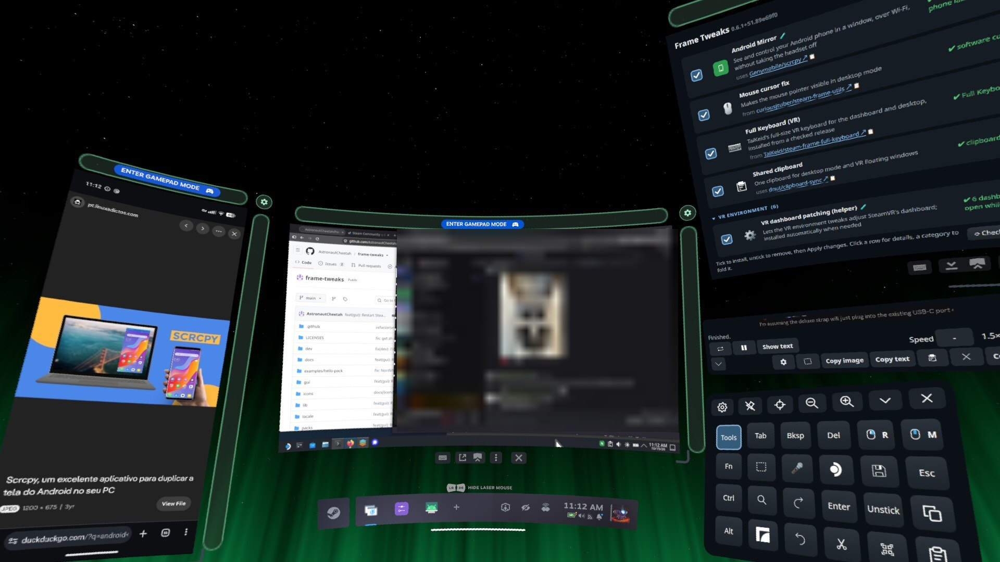
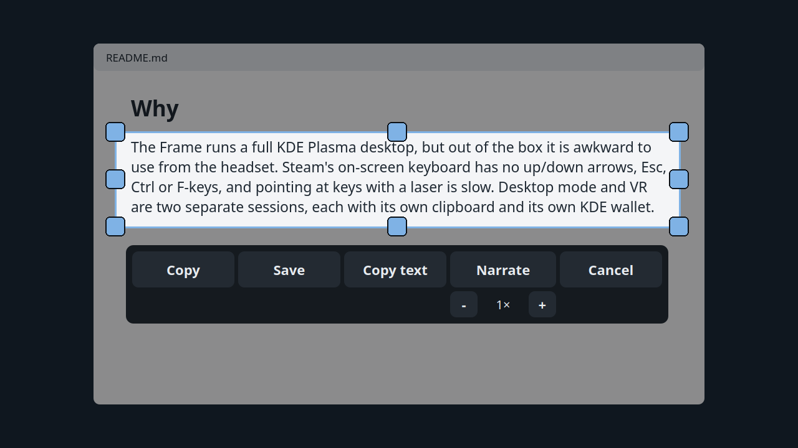
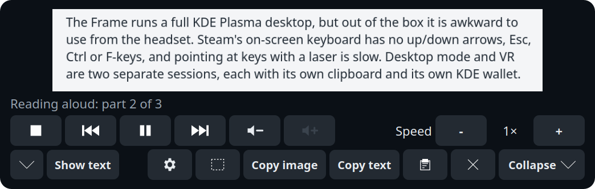
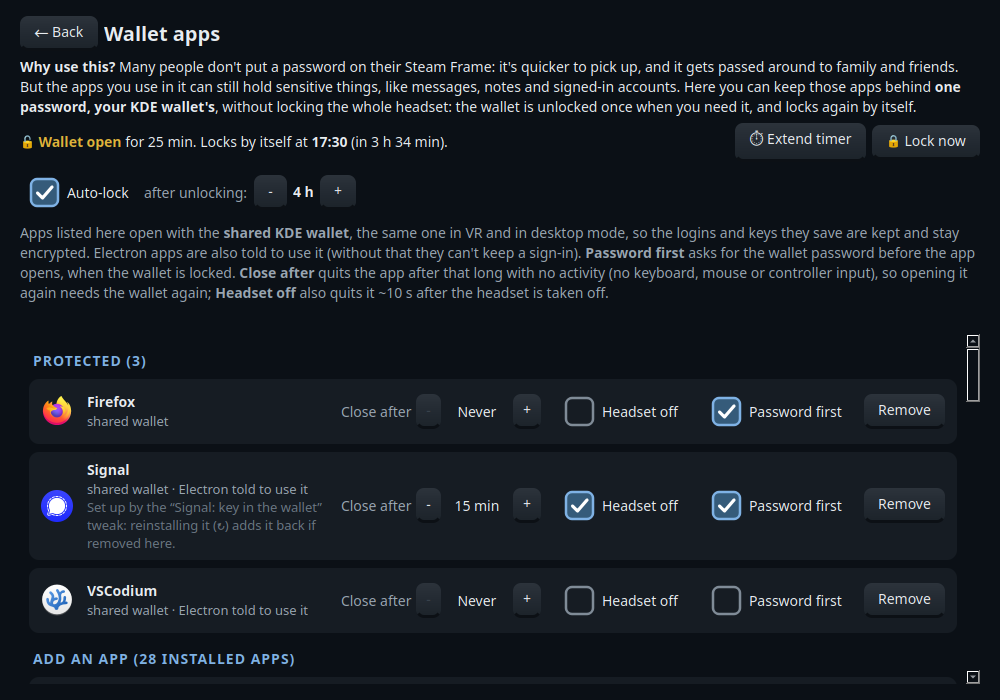

# Frame Tweaks

[](https://github.com/AstronautCheetah/frame-tweaks/actions/workflows/ci.yml)

**Frame Tweaks makes the Valve Steam Frame's desktop mode, and the desktop windows you float in
VR, easier to work in.** It is a checklist of small fixes and add-ons: the keys Steam's
on-screen keyboard is missing, dictation that runs on the headset, curved VR windows, one
clipboard and one KDE wallet for VR and the desktop, and more. Tick what you want; untick it to
remove it again.

<p align="center"><br>
<sub>In the headset: Android Mirror (left), the desktop (middle), and the Frame Tweaks window,
Screen snip's reading panel and Arrow Pad (right).</sub></p>

**Project status:** early (0.x) and changing quickly, tested on one Frame so far
([Tested on](#tested-on)). Reports from other SteamOS and SteamVR versions help a lot, and so
does other help: see [Contributing](#contributing).

## Why

The Frame runs a full KDE Plasma desktop, but out of the box it is awkward to use from the
headset:

- **Typing is hard.** Steam's on-screen keyboard has no up/down arrows, Esc, Ctrl or F-keys, and
  pointing at keys with a laser is slow.
- **Desktop mode and VR are two separate sessions.** Each has its own clipboard and its own KDE
  wallet, so copy and paste between them doesn't work and apps see two different wallets.
- **Small things are missing or broken.** The mouse pointer can be invisible, there's no
  quick way to snip part of a window, copy its text or hear it read aloud, scroll bars are too
  thin to hit with a laser, and windows you float into VR always start flat.
- **SteamOS's system is read-only and updates replace it**, so the usual ways of installing
  software don't last.

Frame Tweaks fixes these one by one, and installs everything in a way that survives SteamOS
updates.

Not affiliated with or endorsed by Valve. Steam and Steam Frame are trademarks of Valve.

## Install

You need:

- A **Valve Steam Frame** in **desktop mode** (tested on SteamOS 0.4.x). The Steam Deck and
  other SteamOS devices aren't supported: Frame Tweaks installs programs built for the Frame's
  ARM processor, and the VR tweaks need the Frame's SteamVR.
- A network connection, and `git` (SteamOS has it).
- Some disk space: a few MB for most tweaks. The bigger ones: the full installer window and Arrow
  Pad share a Python setup of about 280 MB, Dictation's Whisper model is about 260 MB, and
  Homebrew (used by a few tweaks) takes several hundred MB or more, depending on what is in it.
  Each Narrate voice is about 60 MB.

In desktop mode, open **Konsole** and run:

```sh
curl -fsSL https://raw.githubusercontent.com/AstronautCheetah/frame-tweaks/main/get.sh | bash
```

This downloads the newest release into `~/frame-tweaks`, adds **Frame Tweaks** to the app menu
(on the desktop and in Steam's VR "+" menu) and opens the installer window. The first time, it
offers to set up the full window (PyQt6, about 280 MB, usually a minute or two: its progress shows in
a terminal); if you say no, or the window can't open, you get a simpler checklist.
Until you tick a tweak and press **Apply changes**, that's all it installs: the menu entry (with a
small user service that keeps it in your keyboard's language) and, if you said yes, the window's
Python setup.

<p align="center"></p>

<details><summary>Prefer to read the script first?</summary>

```sh
git clone https://github.com/AstronautCheetah/frame-tweaks ~/frame-tweaks
less ~/frame-tweaks/get.sh        # short: finds the newest release, checks it out, opens the installer
~/frame-tweaks/get.sh
```
</details>

**What it touches.** Frame Tweaks installs into your home folder (`~/.local`, `~/.config` and
similar). It never unlocks SteamOS's read-only system (no `steamos-readonly disable`), so
SteamOS updates don't undo it. The few exceptions, each only when you tick the tweak that
needs it:

- **Homebrew** asks for your sudo password once, to create `/home/linuxbrew` (if you never set
  a password for your user, set one first with `passwd` in Konsole).
- **Battery charge limit** asks for it once too, to add a udev rule
  (`/etc/udev/rules.d/90-frame-tweaks-charge-limit.rules`) that lets you pause the battery's
  charging, and again to remove it. Nothing else asks for sudo.
- **NordVPN** adds its connections to NetworkManager (`/etc/NetworkManager/system-connections`).
- **Shared KDE wallet** installs KWalletManager from Flathub, which goes into the system-wide
  Flatpak folder.

Every tweak installs, checks and removes on its own, and removing one keeps your settings
unless you choose otherwise (see [Settings](#settings)).

**Checked downloads.** Files taken from other projects' releases are pinned to a SHA256 checksum
recorded in this repo, and Arch Linux ARM packages are checked against Arch Linux ARM's signing
key. Programs installed through Homebrew, Flathub, pip or a vendor's own installer (the Claude
tweaks) rely on that tool's checks. Details: [SECURITY.md](SECURITY.md#what-each-tweak-changes-on-your-system).

**No telemetry.** Frame Tweaks sends nothing about you or your Frame anywhere. On its own, the
window goes online only to look for newer releases: Frame Tweaks' own (it asks GitHub; turn this
off in its ⚙ preferences) and, for a tweak that installs an app with its own releases, that
app's (Claude Desktop asks Anthropic's download server). Installs and updates download what the
tweaks need. **🐞 Report a problem** saves its report on the Frame and opens GitHub's bug form;
nothing is sent unless you attach it. The apps the tweaks install (Signal, NordVPN, Claude…) go
online as they normally do.

> **What some tweaks can do on your Frame.** VR dashboard patching turns on SteamVR's dashboard
> DevTools port while SteamVR runs (any program on the Frame could use it). Arrow Pad and
> Dictation type through a virtual keyboard (`/dev/uinput`). Each tweak's access is listed in [SECURITY.md](SECURITY.md#what-each-tweak-changes-on-your-system)
> and on its details page in the installer window, so you can check before you tick it.

## What's included

Each tweak's name links to its own README, with how to use it, its settings, how it works and
what to know.

🧪 marks experimental tweaks. They rely on SteamVR's internals, which Valve can change in any
update. They check those internals each time SteamVR starts and switch the affected part off
(their status says so) until an update catches up; nothing else is affected. A few tweaks
need **SteamVR restarted (or a reboot)** once after installing; the installer tells you which.

🔗 marks linked projects: Frame Tweaks runs the project's own installer and uninstaller, as its
README gives them, and it updates its own way ([docs/mods.md](docs/mods.md#linking-a-project)).

*(sudo)* marks tweaks whose install can ask for your sudo (admin) password: Battery charge limit,
and those that use Homebrew while Homebrew isn't installed yet. The Frame Tweaks window tags
their rows **sudo** (the Homebrew ones only until Homebrew is there) and says why on their page.

Grouped as in the Frame Tweaks window. *Helpers* are installed automatically when a tweak needs
them.

<!-- generated:tweaks (dev/gen-docs.py, from each tweak's README front matter) -->
### Accessibility

| | Tweak | What you get | Why on a Steam Frame |
|---|---|---|---|
| ⌨️ | [**Dictation**](packs/core/dictation/) *(sudo)* | Speech-to-text that runs on the headset itself, with whisper.cpp. Press a shortcut (or 🎤 on Arrow Pad's Tools layer) to start, press again to stop; the text is typed into the app you're using and copied to the clipboard. | Typing with controller lasers on a VR keyboard is slow. The Frame can transcribe speech locally, so you can talk instead, and your voice never leaves the headset. |
| ⌨️ | [**Arrow Pad**](packs/core/arrowpad/) | A small floating pad with arrows, Home/End, PgUp/PgDn, Esc, F-keys, one-shot Ctrl/Alt/Super, right- and middle-click keys, clipboard keys, and buttons for dictation and screen snips. It opens in desktop mode or as its own VR panel, and never takes focus from the app you're using. | Steam's on-screen keyboard has no up/down arrows, Esc, Ctrl or F-keys, and most on-screen keyboards don't work under the Frame's Wayland desktop. |
| ✂️ | [**Screen snip + Narrate**](packs/core/snip/) *(sudo)* | Select a rectangle of the window you're using, then copy it, save it, copy its text (OCR) or have it read aloud (Narrate). Arrow Pad's Tools layer has a button for it. | SteamOS comes with no screenshot tool, and the usual desktop ones can't select a region of a window floating in VR. |

### Convenience

| | Tweak | What you get | Why on a Steam Frame |
|---|---|---|---|
| 📱 | [**Android Mirror**](packs/core/adb-scrcpy/) 🧪 *(sudo)* | Shows your Android phone's screen in a window you can click, type and scroll in, over Wi-Fi (scrcpy with Android's wireless debugging). It finds the phone on the network by itself. | Use your phone without taking the headset off. Google's `adb` tool doesn't run on the Frame's ARM processor, so this installs a build that does; in VR, the window takes the phone's shape. |
| 📋 | [**Shared clipboard**](packs/integrations/clipboard/) | Copy in a floating VR window and paste in the desktop, and the other way round: text, files and pictures, and the text you select for a middle-click paste. It runs Frame Tweaks' build of [clipboard-sync](https://github.com/dnut/clipboard-sync), with the changes the Frame needs. | The Frame's VR session and its desktop mode each have their own clipboard, so text copied in one can't be pasted in the other. |
| ⌨️ | [**Full Keyboard**](packs/third-party/full-keyboard/) (VR) 🔗 | TaiKeid's Full Keyboard: a full-size keyboard you type on with the controller lasers, with arrows, F-keys, a numpad, Ctrl/Alt and Copy/Paste. It shows while the SteamVR dashboard is open, and types into the app you're using, desktop mode's included. | Steam's own VR keyboard lacks keys the desktop needs, such as up/down arrows, Ctrl and F-keys. Linked: it installs from its newest release with its own installer, the way its README describes. |
| 🖱️ | [**Mouse cursor fix**](packs/third-party/cursor/) | Makes the mouse pointer visible in desktop mode, on SteamOS before 0.5.6; from 0.5.6, SteamOS shows it itself. | In desktop mode on the Frame, the mouse moves but its pointer isn't shown: the desktop draws it on a separate layer that the headset's view leaves out. |

### VR environment

| | Tweak | What you get | Why on a Steam Frame |
|---|---|---|---|
| 🧩 | [**VR dashboard patching**](packs/core/vr-dashboard/) (helper) 🧪 | The shared part of the VR environment tweaks (Curved world windows, Back to the previous window, Pick up when floating, Scroll strips): it puts their small patches into SteamVR's dashboard while SteamVR runs. Android Mirror uses it too when it's there. Installed automatically. | SteamVR's dashboard, the menu and window space you use in the headset, has no settings for these behaviours. It's a web page, so small patches added to it while SteamVR runs can change them. |
| 🌀 | [**Curved world windows**](packs/core/curvature/) 🧪 | Windows you float into the world start curved, like the dashboard; Toggle Curvature still works. | On the Frame, windows you float out of the dashboard always start flat, and SteamVR has no setting to change that. This presses its Toggle Curvature button for you on each one. |
| ↩️ | [**Back to the previous window**](packs/core/float-return/) 🧪 | After you float the window the dashboard is showing out into the world, the dashboard shows the window it showed before (after 2.5 s), instead of an empty space; and when the shown window closes, it goes back to the one before instead of Steam. | SteamVR leaves the dashboard empty where the floated window was, and falls back to Steam when the shown window closes. This switches back for you, the way a click on that window's dashboard button does. |
| ✋ | [**Pick up when floating**](packs/core/float-grab/) 🧪 | "Float in World" also picks the window up, as grabbing the bar under it does, so you place it in one go; your next click (or letting go of the trigger, if you're still holding it) puts it down. | In SteamVR, floating a window and then placing it takes two steps: press Float in World, then grab the bar under the window. This makes it one. |
| 📜 | [**Scroll strips**](packs/core/scroll-strips/) 🧪 | Big scroll strips beside each window, docked in the dashboard or floating (right and top by default), easy to grab with the laser. Press and drag away from that point to scroll, faster the farther you go; let go to stop. Set them up in the Frame Tweaks window or from a gear beside each window in VR. | In VR you point with a laser, and the scroll bars in desktop apps are sized for a mouse: thin and hard to hit. |
| 🛋️ | [**Recline**](packs/third-party/recline/) 🧪 🔗 | Lie back and keep playing. Recenter while lying back (SteamVR's own recenter) and the direction you're looking becomes level and forward in VR, at a chosen eye height; recentering upright puts everything back. It works for SteamVR apps, and your hands move with you. | SteamVR's own recenter only turns you around; it can't tilt the world, so lying down leaves you looking at the ceiling. Linked: [Recline-VR](https://github.com/new-waifu/Recline-VR) builds and installs itself on the Frame, the way its README describes. |

### System

| | Tweak | What you get | Why on a Steam Frame |
|---|---|---|---|
| 🍺 | [**Homebrew**](packs/core/homebrew/) *(helper)* *(sudo)* | Homebrew, a package manager for command-line programs. It installs everything into `/home/linuxbrew`. | SteamOS's system partition is read-only and wiped by updates, so programs installed there don't last. Homebrew installs outside it, and several tweaks use it for that reason. |
| 🛠️ | [**Desktop Recovery**](packs/core/tools/) | An as-needed fix for a desktop-mode desktop whose taskbar (and system tray) has gone missing: one button, **Restart taskbar**, brings them back (`restart-plasmashell`). | In the Frame's nested desktop, nothing restarts a crashed taskbar automatically, and it has to be relaunched inside that session. |
| ⌨️ | [**ydotool**](packs/core/ydotool/) (helper) | The virtual keyboard that Dictation, Arrow Pad and Scroll strips type through. Installed automatically with them. | On the Frame's desktop (KDE Plasma on Wayland), ordinary programs can't send key presses to other apps. ydotool can: it adds a virtual keyboard to the kernel (`/dev/uinput`), which every app treats as a real one. |
| 🗣️ | [**Speech engine**](packs/core/speech/) (helper) | A voice for the Frame: Piper, an offline, natural-sounding voice, for Screen snip's Narrate. On SteamOS before 0.5.6 it also gives KDE's screen reader (Orca) and other apps that speak through speech-dispatcher a voice, espeak-ng. Installed automatically with Screen snip. | SteamOS has no voice of its own. Before 0.5.6 it had speech-dispatcher, the service apps speak through, but nothing for it to speak with; 0.5.6 removed speech-dispatcher and Orca. |
| 🖼️ | [**Menu icons**](packs/third-party/menu-icons/) | Icons for Konsole, System Settings and other apps that show blank in Steam's VR "+" menu. | Steam only looks icons up in the hicolor theme; these apps' icons exist only in KDE's Breeze theme. |

### Hardware

| | Tweak | What you get | Why on a Steam Frame |
|---|---|---|---|
| 🔋 | [**Battery charge limit**](packs/core/charge-limit/) 🧪 *(sudo)* | Charging stops when the battery reaches the limit you choose (80% unless you change it) and starts again 1% below it, so the battery stays within 1% of the limit. Plugged in, the Frame then runs mostly from the charger or power bank. Charge to 100% once, in its settings, lifts the limit until the next full charge. | A lithium-ion battery wears faster when it's kept full, as it is when the Frame spends a lot of time plugged in, a power bank in your pocket while you play, say. SteamOS offers a charge limit on the Steam Deck (Settings → Power), but not on the Frame. |

### Privacy & security

| | Tweak | What you get | Why on a Steam Frame |
|---|---|---|---|
| 🔐 | [**Shared KDE wallet**](packs/core/wallet/) | Puts the apps you choose behind one password: they ask for the KDE wallet's password before they open, and the wallet locks itself again after a while (4 hours unless you change it). The same wallet works in desktop mode and VR, with an unlock dialog where you are, a **Lock Wallet** button, and a keyring for terminal tools such as `gh`. | Frames are often left without a password or shared with family, yet some apps hold private things. This protects just those apps, without locking the whole headset. It also fixes the Frame's two sessions (VR and desktop) each having their own wallet, which lose each other's logins. |
| 🕵️ | [**Firefox privacy**](packs/core/firefox/) | Makes Firefox harder for websites to track you: it turns on Firefox's strongest anti-fingerprinting (`resistFingerprinting`, from Tor Browser), with letterboxing, WebRTC limits, strict tracking protection, HTTPS-only mode and daily re-randomized canvas readings. | The Frame's hardware (Adreno GPU, the VR desktop's unusual window sizes, touch input) is rare among browsers, so it's easy to fingerprint. |
| 🔐 | [**Signal: key in the wallet**](packs/integrations/signal/) | Signal Desktop keeps the key to your message database in the KDE wallet instead of a plain-text file (an existing plain-text key is moved over), and asks for the wallet password before it opens. | A headset gets passed around, often without a SteamOS login password, and Flathub's Signal otherwise keeps its database key in plain text. |
| 🌐 | [**NordVPN**](packs/integrations/nordvpn/) (WireGuard) | NordVPN servers in several countries as built-in network connections, with a tray icon. Survives SteamOS updates. | The usual NordVPN install goes into `/usr`, which every SteamOS update wipes, and the Frame's desktop has no network applet to switch VPNs. |

### Developer

| | Tweak | What you get | Why on a Steam Frame |
|---|---|---|---|
| 🤖 | [**Claude Desktop**](packs/integrations/claude-desktop/) | Claude Desktop, Anthropic's official Linux app (arm64), installed into your home folder and updated with one command. | Anthropic ships it as an apt package for Ubuntu and Debian. SteamOS has no apt and its system files are read-only, so this unpacks the package into your home folder instead. |
<!-- /generated:tweaks -->

### Screenshots

What the tweaks you open look like (click one to unfold it). The VR environment tweaks work in
SteamVR's dashboard: the picture at the top of this page shows some of them.

<details><summary>⌨️ Arrow Pad, and its Tools layer</summary>

<p align="center"></p>
<p align="center"></p>
</details>

<details><summary>✂️ Screen snip, and Narrate reading a snip aloud</summary>

<p align="center"></p>
<p align="center"></p>
</details>

<details><summary>🔐 Shared KDE wallet: choosing the apps it protects</summary>

<p align="center"></p>
</details>

## Using the installer window

Open **Frame Tweaks** from the app menu, on the desktop or in Steam's VR "+" menu.

- **Tick** a tweak to install it, **untick** it to remove it, then press **Apply changes**.
  Anything a tweak depends on is added for you.
- **Click a row** for its details page: what it is, why it's there, who made it, what it changes,
  and its README.
- The row's **▶** button opens what the tweak provides (Arrow Pad, Dictate, the NordVPN
  tray…). Tweaks with settings have a **⚙ Settings** button instead, or a **⚙** beside their ▶
  (Screen snip, Android Mirror); the wallet's row has **🔑 Wallet apps**, and a tweak with nothing
  to open has **Help**, its details page.
- **↻** removes a tweak and installs it again in one step, keeping its settings.
- Categories fold, and rows or whole categories can be hidden (hiding never removes anything).
- "↑ … available · Update" appears when a newer Frame Tweaks release, or a newer version of an
  app a tweak installs, is out.
- **🐞 Report a problem** saves a diagnostics report and offers the bug form, with your version
  filled in, to attach it to; **🧩 Packs** manages extra packs of tweaks (click one to see what's
  in it); **⚙** holds the
  preferences: the language, how the window behaves, what uninstalling a tweak does with its
  settings, and uninstalling Frame Tweaks itself.
- At the very bottom, under every group, **Help make Frame Tweaks better → Get involved** shows
  the ways to help, from ideas for new tweaks and third-party apps to translations, bug reports
  and code ([docs/contribute.md](docs/contribute.md)).

<p align="center"></p>

## Using the command line

Everything the window does also works from Konsole, in `~/frame-tweaks` (the window uses the
same code, [`lib/sft.py`](lib/sft.py), or the same tools):

```text
./install.sh                    help, and every tweak's status
./install.sh gui                the installer window (desktop mode; --show ID opens on that tweak)
./install.sh list               every tweak and what it does
./install.sh install signal     install (adds what it depends on: here, the wallet)
./install.sh uninstall arrowpad remove one (keeps its settings, unless ⚙ Preferences say to remove them)
./install.sh uninstall --remove-settings arrowpad   remove one and its settings (--keep-settings: keep them)
./install.sh forget-settings    delete the settings uninstalled tweaks left behind (--list: only show them)
./install.sh reinstall arrowpad remove and install again in one step (the ↻ button)
./install.sh status             health check, changes nothing
./install.sh check-system       are the SteamOS/SteamVR parts the tweaks rely on still there?
./install.sh debug-info         a redacted report for bug reports
./install.sh report             the same, and the bug form's address to attach it to
./install.sh info arrowpad      a tweak's details page
./install.sh run arrowpad       its ▶ button
./install.sh settings scroll-strips              show its settings and the allowed values
./install.sh settings scroll-strips color=blue thickness=5   change them (also: --reset)
./install.sh hide nordvpn       hide a row in the window (unhide to show it again)
./install.sh hide-group "VR environment"   hide a whole category (unhide-group)
./install.sh wallet lock        the shared wallet: lock, unlock, status
./install.sh wallet-apps        apps using the wallet (add, --remove, --gate…; --help)
./install.sh timers             close-after timers (--set APP MINUTES, --headset…; --help)
./install.sh menu               put the Frame Tweaks app-menu entry back (--remove takes it out)
./install.sh uninstall-self     uninstall Frame Tweaks itself (see Uninstalling, below)
./install.sh --version          which Frame Tweaks this is
```

`install all` and `uninstall all` take every tweak. The `wallet`, `wallet-apps` and `timers`
commands need [Shared KDE wallet](packs/core/wallet/) installed.

`./install.sh status` shows one line per tweak, for example:

```text
$ ./install.sh status
  ✔ dictation       dictate ready (Homebrew whisper.cpp, small model)
  ✔ arrowpad        arrowpad installed
  ! curvature       waiting for a SteamVR restart (restart SteamVR or reboot once)
  ✔ wallet          wallet locked; 5 app launcher(s) routed/gated
  · claude-desktop  not installed
```

Only one install, update or removal can run at a time, from the window or the terminal.

### Adding your own tweaks

Every tweak comes from a *pack*: a folder of tweak folders, each described by the YAML front
matter of its README.md. Frame Tweaks' own tweaks are in three official packs, all on unless
you turn one off: **Core**, Frame Tweaks' own tweaks for the Frame and the helpers many of them
need, such as Homebrew and ydotool ([`packs/core/`](packs/core/)); **Integrations**, other
projects' apps that Frame Tweaks fits to the Frame ([`packs/integrations/`](packs/integrations/));
and **3rd Party**, other people's projects and fixes for the Frame, most of them linked
([`packs/third-party/`](packs/third-party/)). To try someone's pack, add it from
its link (**🧩 Packs → Add a pack from a link**), or put its folder in
`~/.local/share/frame-tweaks/packs/`; then trust it. A pack's tweaks run as you, so only trust
packs from people you trust. Packs others share: [Community packs](docs/community-packs.md).
How to write one, and share it: [docs/mods.md](docs/mods.md).

```text
./install.sh mods               packs, whether each is in use, problems
./install.sh mods add LINK      add a pack from its git repository's link (not used until trusted)
./install.sh mods trust "My pack" use it (again after its files change); untrust to stop
./install.sh mods update "My pack" its newer version (then trust it again); remove to delete it
./install.sh mods updates       which packs added from a link have a newer version
./install.sh mods off "3rd Party" turn off one of the official packs; on to use it again
./install.sh mods check FOLDER  check a pack or a tweak without using it
```

## Updating

```sh
cd ~/frame-tweaks && ./install.sh update
```

Or, in the Frame Tweaks window: **⟳ Check for updates**, then **⬇ Update to …**, then
**↻ Restart** when it's done (the window also checks when it opens). Running the install command
again does the same. This moves to the newest
release and re-runs the installer of every tweak you have installed (on the newest release
already, it changes nothing, unless an earlier update didn't finish:
`./install.sh update --reinstall` runs the installers again anyway). It first checks that the
release is signed by Frame Tweaks' release key and refuses one that isn't. Nothing updates on its
own: a tweak only changes when you update.

- **Packs:** Frame Tweaks' own packs come with its releases, so a change to them, even to their
  text only, arrives with the next release. For packs added from a link, **⟳ Check for updates**
  also asks where each came from (nothing is downloaded) and says how many have a newer version
  (**🧩 N pack updates**, a link to the Packs page); **Update** on the Packs page gets one (`./install.sh mods updates` lists
  them). Linked tweaks (🔗) update their own way: ↻ on their row runs their installer again.
- **Test releases** (such as `0.7.0-rc.1`, newer and less tested): ⚙ Preferences → **Get test
  releases too**, or `./install.sh channel beta`. Unticking it (`./install.sh channel stable`)
  keeps you on the test release until the next stable one is out, or takes you back at once
  (`./install.sh update --to stable`). To install with test releases from the start:
  `curl -fsSL https://raw.githubusercontent.com/AstronautCheetah/frame-tweaks/main/get.sh | FRAME_TWEAKS_CHANNEL=beta bash`.
- **Go to a specific release** (for example, to go back): `./install.sh update --to vX.Y.Z`
  (0.6.1 or later: older releases aren't signed, so they're refused).
- **Keep one tweak as it is** during updates: `./install.sh hold ID` (`unhold` to undo).

**If updates stop.** What's installed keeps working. If another project deletes or changes a
file a tweak downloads, the installer falls back to Frame Tweaks' own copy, checked against the
same checksum (all but Piper, which can't be copied: it comes with espeak-ng, whose licence would
need its source alongside). Python packages fall back to the newest versions if the tested ones don't
install, and adb and ydotool keep the copy that works if a new build doesn't run on SteamOS.
The first things to stop working are the 🧪 experimental tweaks, after a SteamVR update; they
switch themselves off, and Android Mirror stays usable as a plain window.

## Settings

Each tweak keeps its settings in a few known places, listed in its manifest (`config:`): Arrow
Pad's size and place in `~/.config/arrowpad.json`, Android Mirror's in
`~/.config/frame-tweaks/phone.conf`, and so on. Your data is kept apart and is never removed
with settings: what you dictated (`~/.local/share/dictation-history.txt`), adb's pairing keys
(`~/.android`), saved reports (`~/frame-tweaks-debug-*.txt`).

- **When you uninstall a tweak** its settings are kept, so it's set up as before if you install
  it again. ⚙ Preferences → **Uninstalling a tweak** can make them go with it instead (for one
  run: `./install.sh uninstall --remove-settings ID`, or `--keep-settings`). Removing them also
  signs you out of Claude Desktop and removes NordVPN's key
  (setting it up again takes a new access token). A reinstall (↻) always keeps them.
- **Settings left behind** by tweaks you've uninstalled: ⚙ Preferences → **Delete settings left
  by uninstalled tweaks…** lists them and asks before deleting (`./install.sh forget-settings`;
  `--list` only shows them). An installed tweak's settings are never touched, nor those of a
  tweak whose status is still being checked.

## Uninstalling

In the window: **⚙ Preferences → Uninstalling Frame Tweaks**. First, what happens to the tweaks:

- **Uninstall the tweaks, but keep third-party apps** (the default): the tweaks that install
  another project's app (Homebrew, Claude Desktop, Full Keyboard, clipboard-sync)
  stay, with what they need, so those apps and your work in them stay as they are.
- **Uninstall every tweak, third-party apps too.** Homebrew itself is never removed by Frame
  Tweaks, even then: other programs may live in it, so its tweak only shows Homebrew's own
  uninstall command.
- **Leave every tweak installed:** they keep working, but nothing updates them, and removing
  them later takes Frame Tweaks again (install it, and it finds them).

Then **Also delete the settings** (it starts as your choice for single tweaks): Frame Tweaks' own,
and those of every tweak it removes, now or earlier; tweaks that stay installed keep theirs.

Or in a terminal:

```sh
cd ~/frame-tweaks && ./install.sh uninstall-self                 # tweaks, but third-party apps (Homebrew too) stay
./install.sh uninstall-self --remove-apps --remove-settings      # everything
./install.sh uninstall-self --keep-tweaks                        # only Frame Tweaks itself
```

It uninstalls the tweaks (the ones that depend on others first; it stops if one fails, so you
can run it again), removes the app-menu entry and, once no tweak is left, the files the tweaks
shared, the logs and the Python setup. Then it removes `~/frame-tweaks` itself, unless it holds
work of yours (changes, your own packs, commits not pushed): then it says so and leaves it. It
keeps your own packs in `~/.local/share/frame-tweaks/packs`, and backups of files still waiting
to be put back. If SteamVR was running, VR dashboard patching puts SteamVR's own setting back
when SteamVR stops, and what it needs for that goes then.

Tweaks of packs you turned off, or no longer trust, aren't uninstalled: it names them, and keeps
what they share. To remove them too, turn their pack on (or trust it) first.

**Installing Frame Tweaks again** after leaving tweaks installed: it finds them (each tweak's
status check looks at what's really there), at the version recorded, so updates and uninstalling
work as before. A pack of your own needs trusting again if its settings were deleted.

What stays in any case:

- **Homebrew** (other programs may live in it), with the programs the tweaks installed through it
  (whisper.cpp, scrcpy, Tesseract, wl-clipboard). `./install.sh uninstall homebrew` prints
  Homebrew's own uninstall command; see [homebrew](packs/core/homebrew/).
- **KWalletManager**, the Flathub app Shared KDE wallet installs, and the Flatpak setting that
  has Signal read its database key from the wallet (`flatpak override --user --show
  org.signal.Signal`): the key is there, so Signal needs it to open its messages.
- **Your data in other apps' usual places**, such as the KDE wallet itself and adb's pairing
  keys. Each tweak's uninstaller lists what it keeps as it runs.
- The lines tweaks added to `~/.bashrc` (putting `~/.local/bin` and Homebrew on your `PATH`),
  and `~/.config/environment.d/10-local-bin.conf`. They are harmless; delete them by hand if you
  like.

## Common issues

| Problem | What to do |
|---|---|
| Links open the software store ("Install Chromium"), or Frame Tweaks says your default browser can't open links | SteamOS's "Install Chromium" is a placeholder that only offers to install Chromium, and it can end up as the default web browser. Choose your browser (any: Firefox, Chromium, Brave…) in System Settings → Default Applications → Web browser. Until then Frame Tweaks opens links in an installed browser, a running one first. |
| Arrow Pad or Dictation types nothing | `./install.sh status ydotool`, then ▶ **Restart** on the ydotool row (or `./install.sh run ydotool`). |
| "Failed to initialize Wayland" when opening apps | Closing desktop mode can tear it down halfway: Steam removes the desktop's runtime folder while KWin keeps running. Exit desktop mode and open it again, or reboot. |
| The mouse pointer is invisible in desktop mode | Install **Mouse cursor fix**, then reboot (it takes effect at the next desktop-mode start). |
| Taskbar or tray disappeared | ▶ **Restart taskbar** on the Desktop Recovery row (or `restart-plasmashell`). |
| Wallet password refused, or a second password prompt floats in VR | Only one unlock prompt can be open at a time: close the other one, then unlock from **🔑 Wallet apps** on the wallet's row (or `./install.sh wallet unlock`). See [Shared KDE wallet](packs/core/wallet/). |
| Curved world windows (or another VR tweak) says "waiting for a SteamVR restart" | Restart SteamVR (or reboot) once after installing: SteamVR opens the port these tweaks need only when it starts. |
| Apps show without icons in Steam's "+" menu | Install **Menu icons** (re-run it after installing new apps), then reopen the menu. |
| "Another Frame Tweaks install, update or removal is running" | Wait for the other install window to finish; the lock is released when it closes. |
| Letters come out in the wrong case, or every key acts as if Ctrl/Alt/Super is held | The desktop missed a key's release (often because focus moved to another VR window while the key was down), or a Bluetooth keyboard lost one and still holds the key. On Arrow Pad: **Tools → Unstick** (it releases both). Otherwise turn Caps Lock off, then exit and re-enter desktop mode. |
| Typing and clicks go to the desktop instead of the window you're using, and the desktop's title says "Press right control to **ungrab** input" | **Right Ctrl** toggles the desktop's input grab. On Arrow Pad: **Tools → Unstick** gives it back (and says if it couldn't); or press Right Ctrl once on a keyboard. |
| Something else | Installer window → **🐞 Report a problem**: it saves a report and opens the bug form to attach it to. In a terminal, `./install.sh report` saves it and prints the form's address. |

### Where the logs are

- **Installs, updates and removals:** one log each in `~/.local/state/frame-tweaks/logs/` (the
  last five are kept).
- **The tweaks' background services:** the user journal, for example
  `journalctl --user -u sft-dashboard` (also `ydotoold`, `wallet-lock-sync`,
  `app-timers`).
- **SteamVR drivers, Recline included:** `~/.local/share/Steam/logs/vrserver.txt`.

`./install.sh debug-info` (or **🐞 Report a problem**) gathers the recent install logs, the status of
every tweak and the services' recent lines into one file in your home folder
(`~/frame-tweaks-debug-….txt`). Your user name, home folder, host and phone names, and IP, MAC
and e-mail addresses are removed, but read it before you share it.

## Good to know about the Frame

- **Desktop mode is nested.** Plasma runs inside the Steam/VR session, with its own D-Bus and
  runtime folder (`XDG_RUNTIME_DIR` is `/run/user/$UID/nested_plasma`). Apps started from the
  desktop, from shortcuts and from VR can see different environments, wallets and keyrings. Many
  tweaks here exist because of this; see [Shared KDE wallet](packs/core/wallet/).
- **Anything installed into `/usr`** (with `steamos-readonly disable` and pacman) disappears at
  the next SteamOS update. Prefer home-folder installs, Flatpaks, or settings in `/etc` (as
  [NordVPN](packs/integrations/nordvpn/) does).
- **SteamOS's stock KDE wallet has no password.** Set one; see [SECURITY.md](SECURITY.md).
- **Steam's on-screen keyboard:** hold **Shift** for ←/→. Keyboards that only work on X11
  don't work on the Frame's Wayland desktop.
- **Vulkan apps** can crash in the Gamescope WSI layer; try starting them with
  `DISABLE_GAMESCOPE_WSI=1`.

## How this compares

Other Steam Frame projects, and how this one relates:

| Project | Approach | Overlap |
|---|---|---|
| [lhns/steam-frame-nix](https://github.com/lhns/steam-frame-nix) | Nix Home Manager modules, declarative | Two-session fixes, shared clipboard and wallet (our [wallet](packs/core/wallet/) adapts its launcher approach without Nix), VR keyboard patches |
| [curiousjtuber/steam-frame-utils](https://github.com/curiousjtuber/steam-frame-utils) | `setup.sh` and app installers | Cursor fix (adopted from it, credited), Full Keyboard installer |
| [TaiKeid/steam-frame-full-keyboard](https://github.com/TaiKeid/steam-frame-full-keyboard) | A full-size VR keyboard | Linked by our [Full Keyboard](packs/third-party/full-keyboard/) tweak |
| [techieyann/frame-voice](https://github.com/techieyann/frame-voice), [gripspeak](https://github.com/gripspeak/gripspeak) | Dictation apps | Alternatives to our [Dictation](packs/core/dictation/) |

Frame Tweaks fits if you want a checklist installer without Nix that covers input, VR windows
and the two-session wallet and clipboard problems, with the app setups optional.

## Credits

This builds on [lhns/steam-frame-nix](https://github.com/lhns/steam-frame-nix) (shared clipboard
and wallet launchers, two-session know-how), [curiousjtuber/steam-frame-utils](https://github.com/curiousjtuber/steam-frame-utils)
(cursor fix, proximity sensor), [TaiKeid/steam-frame-full-keyboard](https://github.com/TaiKeid/steam-frame-full-keyboard)
(Arrow Pad style and haptics) and [techieyann/frame-voice](https://github.com/techieyann/frame-voice)
(installer shape), and on whisper.cpp, scrcpy, ydotool, KDE and others. Details and licences:
[CREDITS.md](CREDITS.md). Not affiliated with Valve or any vendor named here.

## Contributing

Help is welcome, and much of it doesn't need a Frame:

- **Reports from your Frame**, especially on SteamOS and SteamVR versions not listed under
  [Tested on](#tested-on): what works, what doesn't (**🐞 Report a problem**).
- **Translations:** [locale/README.md](locale/README.md). Latin American Spanish is the first;
  others are welcome.
- **Fixes and new tweaks.** A tweak is a folder with a README (whose front matter is its
  manifest), `install.sh`, `status.sh` and `uninstall.sh`. The installer, the tweaks' scripts
  and the installer window can all be checked on an ordinary Linux PC with one command
  (`dev/check.sh`, the same checks CI runs). [CONTRIBUTING.md](CONTRIBUTING.md) has the setup,
  [docs/mods.md](docs/mods.md) the tweak format, [docs/DESIGN.md](docs/DESIGN.md) how it all
  fits together, and [docs/roadmap.md](docs/roadmap.md) what's planned.

## Security and licence

- What touches secrets, and the threat model: [SECURITY.md](SECURITY.md). Please report
  security problems privately, through a
  [security advisory](https://github.com/AstronautCheetah/frame-tweaks/security/advisories/new).
- [MIT](LICENSE), except the icons made from KDE Breeze and Noto Color Emoji (their own
  licences; [icons/README.md](icons/README.md)). Changes: [CHANGELOG.md](CHANGELOG.md).

## Tested on

SteamOS 0.4.5 (build 20261007.6125817), SteamVR build 1791331621, kernel 6.18, one Steam
Frame. SteamOS and SteamVR updates can break tweaks that rely on their internals (the 🧪
experimental tweaks check for this and switch themselves off). Reports from other versions are
welcome: the [Works on my Frame](https://github.com/AstronautCheetah/frame-tweaks/issues/new?template=test_report.yml)
issue form asks for what's needed.

## AI use

Much of the code here was written with AI coding assistance. I review every change and test it
on my own Steam Frame, but for now this is a hobby project: it's shared as is, without warranty
([LICENSE](LICENSE)), in good faith that what has helped me on my Frame can help others too.
If something looks wrong, please report it. Contributions are welcome however they were written;
they're held to the same standard, and you're responsible for what you send
([CONTRIBUTING.md](CONTRIBUTING.md)).
