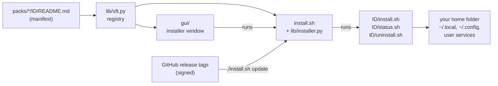

# How Frame Tweaks works

One page, for a first look at the code. [DESIGN.md](DESIGN.md) has the reasons behind each part,
[mods.md](mods.md) how to write a tweak.

## The parts

1. **Packs and tweaks.** A tweak is a folder: a `README.md` whose YAML front matter is its
   manifest (title, what it changes, dependencies, settings), plus `install.sh`,
   `uninstall.sh` and `status.sh`. A pack is a folder of tweaks. The official packs are
   `packs/core`, `packs/integrations` and `packs/third-party`; users can add their own.
2. **The registry.** `lib/sft.py` reads every trusted pack's manifests (`lib/manifest.py`) and is
   the one place both front ends ask: which tweaks exist, what they need, which are hidden or
   not needed on this Frame.
3. **The installer.** `install.sh` is the command line: install, uninstall, status, update,
   tidy. It works out the order (`lib/installer.py`: dependencies first), runs each tweak's
   script with the helpers in `lib/common.sh`, and records what it installed in
   `~/.local/state/frame-tweaks/installed/`.
4. **Status.** Each tweak's `status.sh` prints one line and exits 0, 1 or 2 (the protocol is in
   [mods.md](mods.md#the-scripts)). The window and `./install.sh status` read it the same way.
5. **The window.** `gui/frame-tweaks-gui.py` (PyQt6) shows the tweaks as a checklist with each
   one's status, and runs `install.sh` for what you change. Its pages live in their own modules
   beside it (`details_page.py`, `settings_page.py`, `packs_page.py`, `wallet_page.py`,
   `memory_page.py`, `apply_changes.py`); logic without Qt is in `window_logic.py`.
6. **Updates.** A user's copy is a git checkout of a release tag. `./install.sh update` moves it
   to the newest signed release tag ([release-signing.md](release-signing.md)), then runs the
   installed tweaks' installers again.

## Where things land on a Frame

Everything goes into your home folder, so SteamOS updates, which replace the system partition,
leave it alone: programs in `~/.local/bin`, data in `~/.local/share`, settings in `~/.config`,
user systemd units, and menu entries. The few exceptions, such as Homebrew's folder, are listed
in the README.

## Where to start reading

- A small tweak end to end: [`packs/third-party/cursor/`](../packs/third-party/cursor/) (one
  setting, with `needed.sh` and a status that tracks desktop mode's session).
- The installer's main loop: `cmd_install` in [`install.sh`](../install.sh).
- The checks: [CONTRIBUTING.md](../CONTRIBUTING.md#checks), or `dev/container-check.sh` on any
  machine with Podman or Docker.
