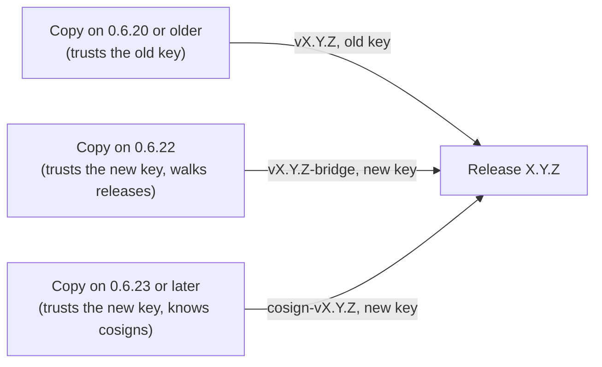

# Release signing and the key bridge

How `./install.sh update` decides a release is genuine, how the release key is changed without
stranding installed copies, and when the current change ends. For what this does and doesn't
protect against, see [SECURITY.md](../SECURITY.md#what-release-signing-protects-against). For
the maintainer's steps, see [CONTRIBUTING.md](../CONTRIBUTING.md#releasing-maintainers).

## The check

Every release is a git tag, `vX.Y.Z`, signed with an SSH key. `dev/release-signers` lists the
public keys a copy trusts. An update (`verify_release` in `lib/common.sh`) moves to a release
only if its tag carries a good signature by a key in the list **as the copy already has it**. A
release can't bring its own key.

A copy may be several releases behind. It then walks the releases in between, oldest first. Each
one it can verify hands on its own `dev/release-signers`, so a copy learns a new key from a
release signed by a key it already trusts. A key a later release drops stops being trusted.

## Changing the key

The key is changed in three steps, each a release:

1. **Announce:** a release signed with the old key lists both keys. Copies that update now
   trust both.
2. **Switch:** releases are signed with the new key and list only it. Copies that walked
   step 1 accept them, and stop trusting the old key.
3. **Bridge:** copies that can't walk, or that skipped step 1, still need a way forward. While
   the bridge runs (the `RELEASE_BRIDGE_KEY` secret is set), each release gets three tags:

| Tag | Signed with | On | For |
|---|---|---|---|
| `vX.Y.Z` | old key | the release commit | copies that trust only the old key and check only the newest release (0.6.20 and older) |
| `cosign-vX.Y.Z` | new key | the same commit | copies from 0.6.23 on, which trust only the new key and accept a cosign on the same commit |
| `vX.Y.Z-bridge` | new key | a side commit listing both keys | copies on 0.6.22, which walk releases but don't know cosigns |

Pre-releases aren't made during the bridge: `vX.Y.Z-rc.N-bridge` would sort after the
pre-release it carries copies to.

## The current bridge, and when it ends

- **Started:** 0.6.23 (27 October 2026). The old key was retired because its private half had
  been on a device that left the maintainer's hands for repair. No sign of misuse was seen.
- **Ends: 11 December 2026.** On that day the `RELEASE_BRIDGE_KEY` secret is deleted and the old
  private key destroyed. Releases after that carry only `vX.Y.Z`, signed with the new key.
- **After the end:** copies on 0.6.21 or later keep updating. Copies on 0.6.20 or older refuse
  every new release, because their update code checks only the newest release against the old
  key, and running the install command again is an update with the same check. They can move the
  old folder aside (`mv ~/frame-tweaks ~/frame-tweaks.old`) and run the README's install
  command for a fresh copy; settings and installed tweaks live outside that folder and stay.

`tests/test_release_signing.py` covers each path: a copy learning the new key on the way, a
cosign counting only by a trusted key on the same commit, bridge tags not bringing the old key
back, and today's update code, on a copy that trusts only the old key, still reaching a release
made after the bridge ends, through the releases in between.

## Keys

- **New key:** the `RELEASE_SIGNING_KEY` repository secret, used only by the Release workflow,
  and an offline copy kept by the maintainer. Never on a Frame.
- **Old key:** the `RELEASE_BRIDGE_KEY` secret and an offline copy, until 11 December 2026.
- **Public keys:** `dev/release-signers`, in every release.
- **If the signing key is lost:** copies can't be told about a new key in a way they'd accept.
  A new key then needs a reinstall from the README, which trusts GitHub's HTTPS for that one
  install.
