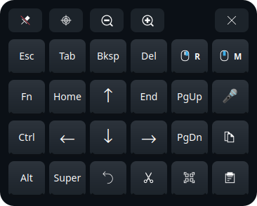
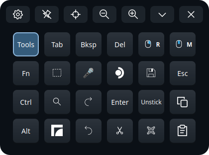

# Arrow Pad

<!-- generated:intro (dev/gen-docs.py, from each tweak's README front matter) -->
A small floating pad with arrows, Home/End, PgUp/PgDn, Esc, F-keys, one-shot Ctrl/Alt/Super, right- and middle-click keys, clipboard keys, and buttons for dictation and screen snips. It opens in desktop mode or as its own VR panel, and never takes focus from the app you're using.

**Why on a Steam Frame:** Steam's on-screen keyboard has no up/down arrows, Esc, Ctrl or F-keys, and most on-screen keyboards don't work under the Frame's Wayland desktop.
<!-- /generated:intro -->

 

## Install

Tick it in the Frame Tweaks window, or:

```sh
./install.sh install arrowpad
```

It sets up [ydotool](../ydotool/) (the helper it types through) and a private copy of PyQt6
(about 280 MB). Nothing else to do: open it from the app menu.

## Use

There are two menu entries. Both work from the desktop's app menu and from Steam's VR "+" menu:

- **Arrow Pad** opens the pad inside desktop mode, as an always-on-top window.
- **Arrow Pad (VR window)** opens it as its own SteamVR panel, like Full Keyboard. It shows
  while the dashboard is open; point at a key and pull the trigger to press it.

They're separate, so you can have both open. Each remembers its own place, size and settings.
Neither takes keyboard focus, so whatever you press goes to the app you were using.

### The keys

```
 main layer                         Fn layer                           Tools layer
 Tools Tab   Bksp  Del  🖱R   🖱M     Tools F1    F2   F3    🖱R    🖱M     Tools Tab  Bksp     Del   🖱R      🖱M
 Fn    Home  ↑     End  PgUp  Esc    Fn    F4    F5   F6    F7    Esc    Fn    Snip 🎤       Launcher Save Esc
 Ctrl  ←     ↓     →    PgDn  Copy   Ctrl  F8    F9   F10   F11   Copy   Ctrl  Find Redo     Enter Unstick Copy
 Alt   Super Undo  Cut  All   Paste  Alt   Super F12  Ins   PrtSc Paste  Alt   Super Undo   Cut   All     Paste
```

- **Fn** and **Tools** switch to another layer. The key stays lit while that layer is showing;
  tap it again to go back.
- **Ctrl, Alt, Super:** tap once and it applies to the next key only. Double-tap to lock it
  (it gets an outline) until you tap it again. A modifier that's on also applies to mouse
  clicks (Ctrl+click, Alt+click). Super shows the Steam Frame logo. Dictation turns them off
  when it starts and when it types, so its text doesn't become shortcuts.
- **Two hands (VR):** hold Ctrl, Alt or Super with one controller's laser and press a key with
  the other. The modifier applies to that key and lets go when you release it.
- **Hold to repeat:** holding a key holds it down, so the app's own key repeat works.
- **Copy, Paste, Cut, Undo, Select all** (icons) send Ctrl+C, Ctrl+V, Ctrl+X, Ctrl+Z and
  Ctrl+A. On the Tools layer, **Find**, **Redo** and **Save** send Ctrl+F, Ctrl+Shift+Z and
  Ctrl+S. The letter is wherever your keyboard layout in KDE has it (on a French keyboard, A
  is where Q is on an English one).
- Keys like these act when you let go of them, once, even if the laser wavered off the key and
  back meanwhile; let go off the key to cancel.
- **🖱R / 🖱M (right / middle click):** tap one, and your **next click anywhere** (laser or
  mouse, on a floating window or the desktop) becomes a right or middle click. The key stays lit
  until then. Only one can be on; tap it again to cancel. It also cancels itself after 10 s, and
  when the pad is hidden or the dashboard closes. Scrolling passes straight through.
- **🎤** (Tools layer) starts and stops [Dictation](../dictation/), if it's installed. It turns
  red while recording and yellow while transcribing. The text goes to the app you're using.
- **Snip** (Tools layer, the dashed rectangle) starts a [Screen snip + Narrate](../snip/), if it's
  installed.
- **Launcher** (Tools layer, the SteamOS logo) taps Super, which opens the desktop's app menu.
- **Unstick** (Tools layer): if the desktop acts as if Shift, Ctrl, Alt or Super were still
  held down, tap this. It presses and releases each of them, and lets go of any key a keyboard
  or mouse still holds (a Bluetooth keyboard that lost a key's release keeps it down for every
  app). If desktop mode has taken all input (its title says "Press right control to **ungrab**
  input", in desktop mode's language: typing and clicks go to the desktop instead of the window
  you're using), it gives it back with a Right Ctrl tap and checks that it did; if not, its
  message says to tap Right Ctrl on a keyboard. What it found goes to
  `~/.local/state/frame-tweaks/logs/unstick.log`, which 🐞 Report a problem includes.

Key labels follow Frame Tweaks' language: the one chosen in the installer window's ⚙, else your
keyboard's when the pad opens; they switch when the window's language changes. They use the
legends printed on that language's keyboards: German *Strg, Entf, Einfg, Pos1, Bild↑*, French
*Échap, Suppr, Début*, Spanish *Supr, Inicio, RePág*, Italian *Canc, Inizio, Pag↑*. Other
languages get the English legends.

### Moving and sizing

The toolbar above the keys has, from left to right: ⚙ **Settings**, 📌 **Pin**, ⌖ **Reset
position**, **−** / **+** (size) and, on the right, ⌄ **Collapse** and ✕ **Close**. Pin stops
accidental moves; its icon shows whether it's on (an upright pin) or off (tilted and crossed out).
Collapse folds the pad down to just its chevron, ⌃ **Expand**, which stays where it was, under
the pointer or the laser, as on Screen snip's panel; the pad remembers it next time.

**In desktop mode:** drag the pad's background to move it. **−** / **+** change the key size
(0.6× to 2×). Reset puts it at the bottom centre of the screen. Opening Arrow Pad again (from
the menu, a shortcut, or `arrowpad --desktop`) hides it, and once more shows it, so a keyboard
shortcut can summon it.

**In VR:** the panel sits just below Steam's dashboard, tilted back 50°, and follows the
dashboard when you move it or re-centre. Reset puts it back there, and opening it again from the
menu re-centres it too. **−** / **+** change its width in 5 cm steps (0.30 to 2 m). To move it,
squeeze the grip while that controller points anywhere on the pad (a squeeze never types), or
hold the trigger on the pad's background, then move your hand. Pushing the controller away or
pulling it closer moves the pad three times as far, so you can send it further off without
walking; up, down and sideways move it one to one. It stays between 0.25 and 3.5 m from you.
When you let go, a slight sideways lean (under 5°) eases level. While Steam's keyboard is
showing, SteamVR hides where your controllers are from other programs, so then the pad slides
flat along its own surface after the laser instead (up, down and sideways only), and a small
note under it says so.

### Which keyboard when?

| Situation | Best tool |
|---|---|
| Typing text in VR, in the dashboard or floating app windows | [Full Keyboard](../../third-party/full-keyboard/) (laser typing, full layout) |
| Quick text entry anywhere | Steam's keyboard (Steam + X). Hold **Shift** for ←/→ |
| Navigating and editing in desktop-mode apps (arrows, selection, shortcuts, F-keys) | **Arrow Pad** |
| Lots of text | [Dictation](../dictation/) (**Tools → 🎤** on the pad, or its shortcut) |
| Nix users who want arrows, Esc and Ctrl inside Steam's own VR keyboard, plus swipe | [steam-frame-nix VR keyboard](https://github.com/lhns/steam-frame-nix/blob/main/docs/keyboard.md) |

## Settings

⚙ on the toolbar opens the settings: Full Keyboard's two themes (**Graphite**, **Midnight**) and
the controller haptics (**Off**, **Light**, **Normal**). Each pad remembers its own, with its
place and size, in `~/.config/arrowpad.json` (desktop) or `~/.config/arrowpad-vr.json` (VR).

From a terminal:

```sh
arrowpad --desktop       # open in desktop mode; run again to hide or show it
arrowpad --vr            # open the VR panel; run again to re-centre it
arrowpad --scale 1.5     # bigger keys in desktop mode (or ARROWPAD_SCALE=1.5)
arrowpad --fold          # collapse a running pad to its chevron, or expand it
arrowpad --quit          # close it (add --desktop or --vr to pick which)
```

## How it works

- **Desktop mode:** the pad runs under XWayland with the X11 "doesn't accept input focus" hint,
  which KWin honours. Native Wayland has no equivalent for ordinary windows.
- **VR:** the pad is drawn off-screen and shown as a native SteamVR overlay, like Full Keyboard.
  A floating window wouldn't do: the Steam session gives a clicked window focus, so the keys
  would go to the pad itself.
- **Keys:** real key down/up events, written straight to `ydotoold`'s socket.
- **Right/middle click:** laser clicks don't pass through anything else the pad can see, so it
  grabs the pointer on the Steam session's display for that one click and replays it as the
  other button. Each step is logged in `/run/user/$UID/arrowpad-clicks.log`.
- **Haptics:** a light tick when the laser moves onto a key and a click when you press one, on
  the controller that's pointing, with Full Keyboard's values. SteamVR only sends haptics to the
  app that has input focus, which the VR panel has while you point at it; the desktop pad, an
  ordinary window, may not get them.
- **Grip:** the dashboard hides the grip button from apps, so the pad reads it the way Full
  Keyboard does: from how far the grip part of the controller's 3D model has moved.
- **Moving it while Steam's keyboard shows:** SteamVR's keyboard privacy hides the controllers'
  poses from every other program while its keyboard is open (its log says
  `AddSystemBehaviorFlag SystemBehaviorFlag_SystemKeyboardPrivacy`), so a grab can't follow the
  controller. The pad then slides in its own plane to keep the point you grabbed under the laser.
- **Typing on Steam's keyboard after touching the pad:** Steam's keyboard follows the laser's
  focus (SteamVR logs `Reopening keyboard follow overlay focus`), so a press on the pad hands it to
  the pad, and what's typed on it comes to the pad as `VREvent_KeyboardCharInput`. The pad types it
  on the desktop through ydotoold, on the desktop's layout, with its latched modifiers: Ctrl on the
  pad, then C on Steam's keyboard, is Ctrl+C. Its log (`/run/user/1000/arrowpad-input.log`) counts
  the keys, never what they were. The keyboard also moves to another spot when that happens;
  SteamVR's dashboard decides where it goes, and there's no setting for that yet.
- **PyQt6** lives in a private venv (`~/.local/share/arrowpad/venv`), because SteamOS ships no
  Python GUI toolkit. The [NordVPN](../../integrations/nordvpn/) tray and Screen snip use the same one.

## Good to know

- Closing the dashboard lets go of any Ctrl, Alt or Super the VR panel had on, and of any key a
  laser is holding down, so your clicks don't turn into Ctrl+clicks, nor a key keep repeating,
  while it's out of sight.
- **Arrow Pad** (the desktop one) needs desktop mode to be running.
- Controller haptics need SteamVR's own arm64 OpenVR library. Without it, the pad works without
  haptics, and the VR panel can't start.
- If a crash ever happens, `/run/user/$UID/arrowpad-desktop-crash.log` or
  `arrowpad-vr-crash.log` says where.

<!-- generated:changes (dev/gen-docs.py, from each tweak's README front matter) -->
## What it changes

- **Survives SteamOS updates:** Yes (everything is in your home folder)
- **Changes:** `~/.local/bin/arrowpad`, `~/.local/share/arrowpad` (including a ~280 MB PyQt6 venv), two app-menu entries
- **Unusual access:** Types through ydotool. In VR: a SteamVR overlay; reads each controller's grip position (from its 3D model's state, as Full Keyboard does). **The R/M keys grab the pointer on the Steam display (`:0`) for one click** (at most 10 s) and replay it with XTEST
- **Undo:** `./install.sh uninstall arrowpad` (keeps your settings: `~/.config/arrowpad.json` and `~/.config/arrowpad-vr.json`)
<!-- /generated:changes -->

## Credits

- [TaiKeid/steam-frame-full-keyboard](https://github.com/TaiKeid/steam-frame-full-keyboard)
  (MIT): the look (its Graphite and Midnight theme colours and key drawing), the toolbar (pin,
  recenter, size), the copy/paste keys, relaunch to toggle or recenter, the haptic values, the
  placement under the dashboard, grip reading, easing a lean level after a grab, and letting go
  of input when the dashboard closes. The toolbar, copy/paste, Super and Launcher icons are
  ported from its `src/panel.cpp` (Copyright (c) 2026 TaiKeid and contributors, MIT; the notice
  is in `arrowpad.py`).
- [lhns/steam-frame-nix](https://github.com/lhns/steam-frame-nix)'s VR keyboard (Apache-2.0):
  the idea of one-shot and locked modifiers and an F-key layer. No code copied.
- The other key icons are [KDE Breeze](https://invent.kde.org/frameworks/breeze-icons)
  (LGPL-3.0-or-later), loaded from SteamOS's own icon theme. Its menu icon is a Breeze glyph on a
  coloured tile, drawn by `dev/draw-icons.py` ([icons/README.md](../../../icons/README.md)).
- [pyopenvr](https://github.com/cmbruns/pyopenvr) (BSD-3-Clause) for the VR panel and haptics;
  [PyQt6](https://www.riverbankcomputing.com/software/pyqt/) (GPL-3.0) draws the pad;
  [ydotool](https://github.com/ReimuNotMoe/ydotool) (AGPL-3.0) types.

See also [CREDITS.md](../../../CREDITS.md).

---
Check: `./install.sh status arrowpad` · Remove: `./install.sh uninstall arrowpad`
