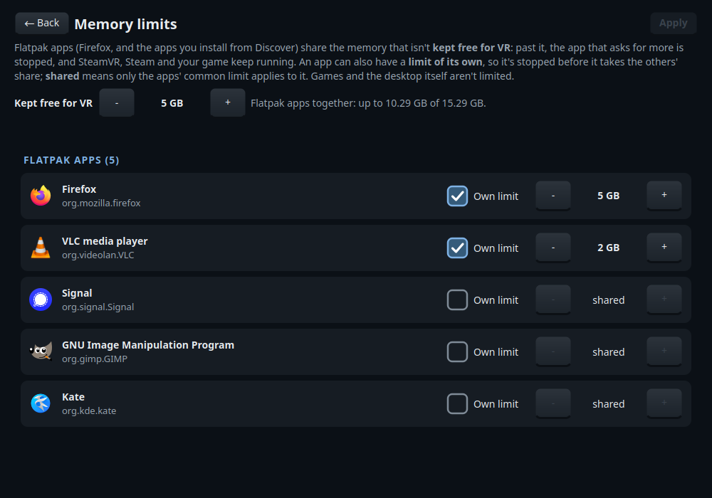

# VR memory guard

<!-- generated:intro (dev/gen-docs.py, from each tweak's README front matter) -->
Flatpak apps (Firefox and others from Discover) together always leave 5 GB for SteamVR, Steam and your game; Firefox gets a 5 GB limit of its own, and any other app can have one too (its Memory limits page); and when memory runs out anyway, SteamVR is the last thing stopped.

**Why on a Steam Frame:** The Frame's 16 GB is shared by VR and every app you open. When one app takes it all (signing in to Firefox can install all your extensions at once and take 10 GB), the whole headset stalls and SteamVR's compositor can crash, dropping you out of VR.
<!-- /generated:intro -->



## Install
Tick it in the Frame Tweaks window, or:

```sh
./install.sh install vr-memory-guard
```

The limits apply at once to apps already open. SteamVR takes its place in the queue the next
time it starts.

## What it does
- **Flatpak apps leave a reserve for VR.** Every Flatpak app (Firefox, and the apps you
  install from Discover) shares one limit: the Frame's memory minus 5 GB. If they reach it, the
  app that asks for more is stopped; SteamVR, Steam and your game keep running.
- **Firefox has its own limit (5 GB).** Above it, Firefox stops one of its processes (a tab
  shows "Gah. Your tab just crashed.", or Firefox closes) before anything else is affected.
- **Any other app can have one too.** On the Memory limits page, an app with a limit of its own
  is stopped before it takes the other apps' share; one left "shared" has only the apps' common
  limit.
- **SteamVR is given priority.** If memory runs out anyway, the kernel picks an app before
  SteamVR.

**Not limited:** games you start from Steam, and the desktop itself with its own programs
(Discover, Konsole, Dolphin and the like). They run in Steam's session, with SteamVR, and how
much memory they need is up to Valve and the game's developers.

## Settings
**In the Frame Tweaks window:** once it's installed, **📊 Memory limits** on its row opens a page
with every Flatpak app you have installed. Tick **Own limit** to give an app a limit of its own
and set it with − and + (half a GB a press); unticked, the app is **shared**: only the limit all
Flatpak apps share applies to it. **Kept free for VR** at the top sets how much memory the apps
leave for SteamVR, Steam and your game, and shows what that leaves the apps. Nothing changes until
you press **Apply** (top right, dimmed until you change something): it saves the limits and puts
them in force, for the apps open now too.

**In a terminal:** the page runs `vr-memory-guard-tool`, which you can run yourself:

| Command | What it does |
|---|---|
| `vr-memory-guard-tool list` | Your installed Flatpak apps, each with its limit (and swap) or `shared` |
| `vr-memory-guard-tool set org.signal.Signal 2G` | A limit of its own (sizes such as `512M` or `5G`, 256M at least, no more than the apps' limit); a swap size after it, such as `512M`, sets its swap too (1G if never set) |
| `vr-memory-guard-tool set org.signal.Signal shared` | No limit of its own |
| `vr-memory-guard-tool reserve 6G` | The memory kept free for VR (1G at least, and at least 2 GB left for the apps) |
| `vr-memory-guard-tool apply` | Puts what you set in force (`set` and `reserve` only save) |
| `vr-memory-guard-tool check` | Says whether the settings can be applied, and changes nothing |
| `vr-memory-guard-tool info` | All of it as JSON (what the page reads) |

Each app's own limit is kept in `~/.config/frame-tweaks/vr-memory-guard-apps.conf`, one app a
line: its Flatpak app ID, then a limit and optionally its swap, or `shared`. An app not listed is
shared. A fresh install lists Firefox with its 5 GB:

```
org.mozilla.firefox 5G 1G
org.signal.Signal shared
```

The rest is in `~/.config/frame-tweaks/vr-memory-guard.conf` (sizes in `M` or `G`):

| Setting | Default | Meaning |
|---|---|---|
| `reserve_for_vr` | 5G | Memory Flatpak apps leave free for VR |
| `apps_swap_max` | 2G | How much of their memory may go to swap |
| `dictation_max` | 2500M | Dictation's services (see below) |
| `mirror_max` | 1G | Android Mirror's scrcpy (see below) |

After editing either file by hand (for example `nano ~/.config/frame-tweaks/vr-memory-guard.conf`),
run `vr-memory-guard-tool apply`, or `./install.sh install vr-memory-guard` again for Dictation's
and Android Mirror's limits.

**Firefox's limit from before:** it was `firefox_max` and `firefox_swap_max` in
`vr-memory-guard.conf`. Where they're still there, the next install (or `apply`) moves them into
Firefox's line in `vr-memory-guard-apps.conf` and comments them out, so Firefox keeps the limit
you gave it. A `firefox_max=` line written there again later is moved the same way, and takes the
place of Firefox's line.

## How it works
- Each Flatpak app runs in its own systemd scope (`app-flatpak-<id>-<number>.scope`), in the
  slice `app.slice`. A few small background services share that slice and its limit (SteamOS's
  manager and portals, Frame Tweaks' VR dashboard helper); everything else, Steam and its games
  included, runs in `session.slice`, which isn't limited. A drop-in gives the slice a `MemoryMax`, and one for
  the scope name prefix of each app with a limit of its own (`app-flatpak-org.mozilla.firefox-`
  for Firefox) gives every copy of that app its own. Apply also sets the running slice and those
  apps at once (`systemctl --user set-property --runtime`), because a running slice doesn't take a
  new drop-in until the next login; an app made shared has its drop-in removed and its limit
  lifted.
- There's no `MemoryHigh`. With it, the kernel slows an app down instead of stopping it, and in
  tests on a Frame a runaway app went on crawling for minutes. `MemorySwapMax` stops it growing
  into swap instead.
- Frame Tweaks' own heavy helpers, which aren't Flatpak apps, get limits of their own:
  Dictation's services (Whisper for each dictation, or the engine kept loaded) up to
  `dictation_max` (2500M), and Android Mirror's scrcpy up to `mirror_max` (1G). Android Mirror
  runs scrcpy in a slice of its own inside the apps' (`app-ftmirror.slice`): opened from Steam's
  "+" menu it otherwise ran inside Steam's service, which nothing limits.
- SteamVR's service gets `OOMScoreAdjust=100`. Apps run at 200, and 100 is the lowest a user's
  own service may set.
- No root: your own systemd user manager applies all of it.

## Good to know
- **Signing in to Firefox** can install all your synced extensions at once. With this tweak,
  Firefox may close during that; open it again and the rest install. To avoid it, turn off
  syncing add-ons for this device (Firefox Settings → Sync).
- An app that genuinely needs more (a big video edit, say) is stopped at the limit: raise its
  own limit, make it shared, or keep less for VR (Memory limits page).
- The limits need systemd to hand the memory controller to your services, as SteamOS does on
  the Frame. The status line warns if it doesn't, and `./install.sh check-system` checks it.

<!-- generated:changes (dev/gen-docs.py, from each tweak's README front matter) -->
## What it changes

- **Survives SteamOS updates:** Yes (everything is in your home folder)
- **Changes:** `~/.config/frame-tweaks/vr-memory-guard.conf` and `vr-memory-guard-apps.conf`, `vr-memory-guard-tool` in `~/.local/bin`, and systemd drop-ins for your Flatpak apps (each app with a limit of its own too), SteamVR, Dictation's services and Android Mirror's slice in `~/.config/systemd/user/`
- **Unusual access:** Sets memory limits on your own systemd services (no root)
- **Undo:** `./install.sh uninstall vr-memory-guard` (keeps your limits files)
<!-- /generated:changes -->

---
Check: `./install.sh status vr-memory-guard` · Remove: `./install.sh uninstall vr-memory-guard`
