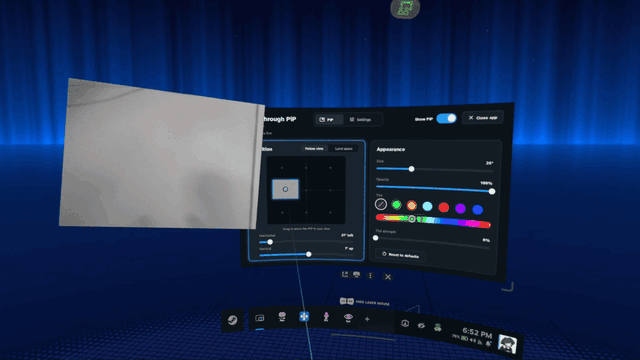

# Passthrough PiP

<!-- generated:intro (dev/gen-docs.py, from each tweak's README front matter) -->
Sippbox's frame-passthrough-pip: a small, monochrome view from the headset's passthrough cameras, over whatever you're playing, pinned to your view or placed in the room, with a panel in the SteamVR dashboard for its settings. Installed from its GitHub release, the way its README describes.

**Why on a Steam Frame:** Passthrough on the Frame replaces the game, so checking the room, a drink or a controller means leaving it. This keeps a camera view in the corner of any game, streamed or standalone.
<!-- /generated:intro -->

A **link**: Frame Tweaks runs frame-passthrough-pip's own steps, as its
[README](https://github.com/Sippbox/frame-passthrough-pip#readme) gives them, in the terminal it
opens for installs, and doesn't change what they install.

- **Install** (tick it): downloads the release Frame Tweaks tested (`link-frame-passthrough-pip`
  in `lib/tested-versions`) and its `SHA256SUMS.txt` from GitHub, checks the one against the
  other (`sha256sum -c`) and runs the AppImage with `--install`: its README has you open the
  AppImage and click **Install**; this is the same installer without the first question. It
  asks whether to restart SteamVR, which loads its camera driver. One step is added after it:
  enabling its user service with the Steam session's bus, the one thing an installer can't do
  from the desktop-mode terminal Frame Tweaks runs it in (there `systemctl --user` fails
  quietly, and the app would sit installed and never start with SteamVR).
- **Update:** when Sippbox publishes a release newer than the one Frame Tweaks tested, its row
  offers it as *not yet tested by Frame Tweaks* (↑ *version* available · **Update**); once it's
  installed, **↩ Back to the tested version** installs the tested one again. Frame Tweaks' own
  updates move it to a newer tested version, never to an untested one.
  `./install.sh link-version frame-passthrough-pip tested|newest` does the same.
- **Uninstall** (untick it): downloads the release again and runs the AppImage with
  `--uninstall`, which removes the app, its driver and its settings (`~/.config/framepip`). The
  driver stays loaded until SteamVR restarts.

## Use

With SteamVR running, the camera view comes up on its own; its panel in the SteamVR dashboard
has the settings (where the view sits, its size, lock in place), and double-tapping **View** on
the left controller shows or hides it. **Open** on its row in the Frame Tweaks window starts it
if it isn't running and opens that panel; if an install left its service disabled, Open also
enables it so it starts with SteamVR again (`./install.sh run frame-passthrough-pip` does the
same; the status says when that's needed).

- **SteamVR restarts once** at the install, to load the camera driver, which reloads the whole
  headset session: save anything open first, or say Later and restart SteamVR yourself.
- **Grabbing it with grip** can also grab things in a game: use **Lock in place** if that gets in
  the way.
- Monochrome, about 30 frames per second. Measured on a Frame: about 9% of one CPU core and
  43 MB while live. Logs: `journalctl --user -u framepip`.

<!-- generated:changes (dev/gen-docs.py, from each tweak's README front matter) -->
## What it changes

- **Survives SteamOS updates:** Yes (everything is in your home folder); a SteamOS or SteamVR update can break it
- **Changes:** What its AppImage's installer sets up, all in your home folder: the app and its camera driver in `~/.local/share/framepip` (the driver registered with SteamVR), a user service (`framepip.service`) that starts it with SteamVR, and an app-menu entry; settings in `~/.config/framepip`
- **🧪 Experimental:** Reads the cameras through a SteamVR driver of its own, which relies on undocumented SteamVR details: a SteamOS or SteamVR update can break it, and SteamVR restarts once to load the driver. Tried on a Frame on 3 November 2026 (SteamOS 0.5.6 beta, release 0.9.1): the camera came up, at about 9% of one CPU core and 43 MB while live, with no measurable extra load on SteamVR's compositor. Untested with the Arcturus Vision camera accessory.
- **Unusual access:** Reads the headset's tracking cameras through its own SteamVR driver; a SteamVR overlay with a dashboard panel; a controller binding (double-tap View on the left controller)
- **Undo:** Uncheck it, or `./install.sh uninstall frame-passthrough-pip`: its AppImage's own uninstall, which removes the app, its driver and its settings. The driver stays loaded until SteamVR restarts.
<!-- /generated:changes -->

## Credits

frame-passthrough-pip is by [Sippbox](https://github.com/Sippbox/frame-passthrough-pip) (MIT).
Frame Tweaks only runs its install steps. This tweak's icon, `frame-passthrough-pip.png`, is its
own app icon (`resources/icon.png`, MIT), resized to 256 px and otherwise unchanged. Listed in
[frame-commons' field guide](https://github.com/frame-commons/catalog/blob/main/GUIDE.md#passthrough).
The picture above is one frame of its README's animation (`resources/readme/adjusting.gif`, MIT). See also [CREDITS.md](../../../CREDITS.md).

---
Check: `./install.sh status frame-passthrough-pip` · Remove: `./install.sh uninstall frame-passthrough-pip`
