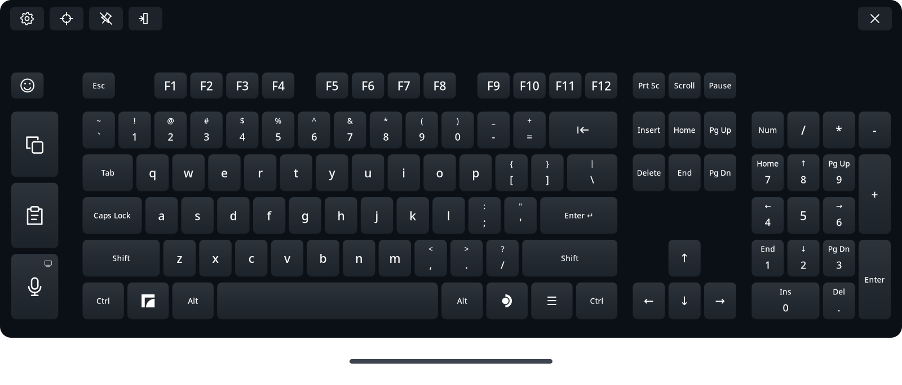

# Full Keyboard

<!-- generated:intro (dev/gen-docs.py, from each tweak's README front matter) -->
TaiKeid's Full Keyboard: a full-size keyboard you type on with the controller lasers, with arrows, F-keys, a numpad, Ctrl/Alt and Copy/Paste. It shows while the SteamVR dashboard is open, and types into the app you're using, desktop mode's included.

**Why on a Steam Frame:** Steam's own VR keyboard lacks keys the desktop needs, such as up/down arrows, Ctrl and F-keys. Linked: it installs the release Frame Tweaks tested with its own installer, the way its README describes.
<!-- /generated:intro -->

A **link**: Frame Tweaks runs Full Keyboard's own steps, as its
[README](https://github.com/TaiKeid/steam-frame-full-keyboard#readme) gives them, in the terminal
it opens for installs, and doesn't change what they install.

- **Install** (tick it): downloads the release Frame Tweaks tested (`link-full-keyboard` in
  `lib/tested-versions`) and its `SHA256SUMS` from GitHub, checks
  the one against the other (`sha256sum -c`), unpacks it and runs its `install.sh`. Nothing else
  to do.
- **Update:** when TaiKeid publishes a release newer than the one Frame Tweaks tested, its row
  offers it as *not yet tested by Frame Tweaks* (↑ *version* available · **Update**); once
  it's installed, **↩ Back to the tested version** installs the tested one again. Frame
  Tweaks' own updates move it to a newer tested version, never to an untested one.
  `./install.sh link-version full-keyboard tested|newest` does the same.
  Full Keyboard's installer installs an older release over a newer one too.
- **Uninstall** (untick it): removes `~/.local/bin/framekeyboard`, its app-menu entry and
  `~/.local/share/framekeyboard` (every installed release), and keeps your settings, layouts and
  themes in `~/.config/framekeyboard`.

Install, update and uninstall close the keyboard first if it's open.

## Use

With the VR session running, open **Full Keyboard** from the dashboard's app launcher. Focus a
text field, then type with the controller laser. Opening it again re-centres it. It's a separate
app: the system keyboard button still opens Steam's keyboard. The full guide is TaiKeid's
[README](https://github.com/TaiKeid/steam-frame-full-keyboard#readme).

- **It shows only while the SteamVR dashboard is open**, whichever menu started it: closing the
  dashboard hides it. To type into desktop mode, open the dashboard over it.
- **To move it,** point at it and squeeze grip, with either hand; while you hold grip, the
  thumbstick moves it nearer or farther. After opening it, let go of grip once first. It reads
  the grip of the Frame's own controllers only.

Not sure which keyboard to use? See the [keyboard guide](../../core/arrowpad/README.md#which-keyboard-when).

<!-- generated:changes (dev/gen-docs.py, from each tweak's README front matter) -->
## What it changes

- **Survives SteamOS updates:** Yes (everything is in your home folder)
- **Changes:** Whatever Full Keyboard's own installer sets up (its README lists it): its release in `~/.local/share/framekeyboard`, with `~/.local/bin/framekeyboard` and an app-menu entry. With Frame Tweaks' Dictation installed, its on-device dictation model is the same file as Dictation's: a hard link to it in `~/.local/share/framekeyboard/models`, so it's on disk once and isn't downloaded again
- **Unusual access:** A SteamVR overlay; types into the app you're using
- **Undo:** Uncheck it, or `./install.sh uninstall full-keyboard`: Full Keyboard's own removal steps (keeps its settings in `~/.config/framekeyboard`)
<!-- /generated:changes -->

## Credits

Full Keyboard is by [TaiKeid](https://github.com/TaiKeid/steam-frame-full-keyboard) (MIT).
Frame Tweaks only runs its install steps. The screenshot above is Full Keyboard's own (`docs/images/keyboard-graphite.png`, MIT), unchanged. See also [CREDITS.md](../../../CREDITS.md).

---
Check: `./install.sh status full-keyboard` · Remove: `./install.sh uninstall full-keyboard`
